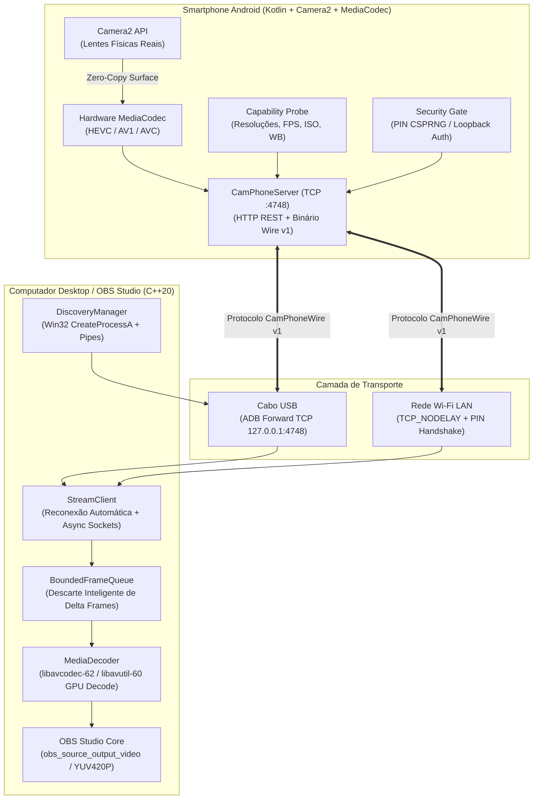

# 📚 Base de Conhecimento e Arquitetura Técnica — CameraPhone 4K Pro

Este documento reúne e transfere todo o conhecimento técnico, decisões de design, engenharia reversa de concorrentes, desafios de baixo nível resolvidos e a especificação da arquitetura do projeto **CameraPhone**.

---

## 📑 Índice
1. [Visão Geral e Manifesto do Projeto](#1-visão-geral-e-manifesto-do-projeto)
2. [Engenharia Reversa de Soluções Existentes](#2-engenharia-reversa-de-soluções-existentes)
3. [Arquitetura Geral do Sistema](#3-arquitetura-geral-do-sistema)
4. [App Android (Kotlin + Camera2 + MediaCodec)](#4-app-android-kotlin--camera2--mediacodec)
5. [Protocolo de Streaming Binário (CamPhoneWire v1)](#5-protocolo-de-streaming-binário-camphonewire-v1)
6. [Plugin Nativo C++20 para OBS Studio (cameraphone.dll)](#6-plugin-nativo-c20-para-obs-studio-cameraphonedll)
7. [Motor ADB e Conexão via Cabo USB](#7-motor-adb-e-conexão-via-cabo-usb)
8. [App Companion e Instalador Desktop (CameraPhone.exe)](#8-app-companion-e-instalador-desktop-cameraphoneexe)
9. [Infraestrutura de Testes e Validação](#9-infraestrutura-de-testes-e-validação)
10. [Guia de Manutenção, Compilação e Deploy](#10-guia-de-manutenção-compilação-e-deploy)

---

## 1. Visão Geral e Manifesto do Projeto

### O Problema
Webcams dedicadas tradicionais de mercado (mesmo modelos de R$ 1.000 a R$ 2.500) utilizam sensores minúsculos (1/3" ou 1/4"), com lentes de plástico de abertura fixa, ruído excessivo em baixa luz e compressão JPEG ou H.264 de baixa qualidade. Em contraste, qualquer smartphone intermediário ou topo de linha recente possui sensores de até 1 polegada, lentes físicas múltiplas de alta precisão (aberturas até f/1.6), Estabilização Óptica (OIS), HDR de 10 bits e SoCs com processadores de sinal de imagem (ISP) e encoders de vídeo de hardware dedicados.

### A Solução CameraPhone
O **CameraPhone** é uma solução de engenharia limpa (*clean-room*), 100% gratuita e de código aberto (Open-Source), concebida para:
- Entregar vídeo **4K60** e **1080p120** real sem compressão destrutiva.
- Eliminar paywalls, marcas d'água e assinaturas mensais.
- Integrar-se diretamente à pipeline do **OBS Studio** como uma fonte nativa (sem depender de drivers virtuais DirectShow/V4L2 instáveis).
- Fornecer segurança **Zero-Trust** contra invasões na rede local e oferecer conexão **Zero-Config** plug-and-play via cabo USB.

### Tabela Comparativa de Mercado

| Recurso / Critério | ❌ DroidCam / DroidCam OBS | ❌ Elgato EpocCam / Camo | ✅ CameraPhone (Este Projeto) |
| :--- | :--- | :--- | :--- |
| **Resolução 4K UHD (3840x2160)** | Bloqueada / Requer compra | Paywall / Assinatura anual | **100% Liberada Nativamente** |
| **Taxas de Quadros (FPS)** | 30 / 60 FPS fixos | 30 / 60 FPS fixos | **24 / 30 / 60 / 120 FPS High-Speed** |
| **Codecs em Hardware** | AVC (H.264) e MJPEG legado | AVC (H.264) | **HEVC (H.265), AV1 e AVC** (até 150 Mbps) |
| **HDR 10-bit** | Não suportado (apenas 8-bit SDR) | Inexistente | **HLG10 / HDR10 (BT.2020)** no Android 13+ |
| **Lentes Físicas** | Apenas genéricas (traseira/frontal) | Limitado a zoom digital | **Descoberta de todas as lentes reais** (Ultra-Wide, Telefoto, etc.) |
| **Controles Manuais Pro** | Bloqueados com HTTP 550 na versão grátis | Requer versão Pro | **100% Liberados:** ISO, Shutter, Kelvin WB, Zoom, Torch |
| **Marca D'água** | Injetada no vídeo após timer | Injetada na versão free | **Zero Marca D'água** |
| **Segurança de Rede** | Porta aberta sem senha na LAN | Servidor local sem PIN | **Zero-Trust:** PIN CSPRNG + Túnel USB Loopback |
| **Custo** | Pago / Paywalls agressivos | Assinatura mensal/anual | **100% Gratuito & Open-Source** |

---

## 2. Engenharia Reversa de Soluções Existentes

Durante a fase inicial do projeto, decompilamos e analisamos a fundo as implementações do DroidCam e DroidCam OBS. Os detalhes técnicos revelaram gargalos graves que foram rigorosamente evitados no CameraPhone:

### 2.1. Bloqueios Artificiais e Paywalls por Software
1. **Injeção de Marca D'água via Timer:**
   - O DroidCam inicia a transmissão normalmente, mas inicia uma thread em background (`WatermarkTimer`) que, após alguns minutos, substitui os pixels centrais do buffer de vídeo por uma logo em bitmap caso a chave de licença não esteja salva no `SharedPreferences`.
2. **Bloqueio de Controles Pro (HTTP 550):**
   - Ao enviar comandos de ajuste de foco, exposição ou zoom na versão gratuita, o servidor responde com código `HTTP 550 Pro Feature Required`.
3. **Resoluções Hardcoded no C++ do Plugin:**
   - O código do plugin desktop continha uma lista estática de resoluções (`1280x720`, `1920x1080`), sem interrogar as reais capacidades do sensor do aparelho (`CameraCharacteristics`).

### 2.2. Falhas Críticas de Segurança na Rede
- **Servidor HTTP desprotegido:** O app Android sobe um servidor HTTP na porta `4747` escutando em `0.0.0.0` sem nenhuma forma de autenticação. Qualquer dispositivo na mesma rede Wi-Fi (roteadores compartilhados, cafés, faculdades, empresas) podia conectar à porta e assistir à câmera ao vivo ou enviar comandos remotos sem o usuário saber.
- **Vulnerabilidade a DoS e Força Bruta:** Não havia limitação de taxa de requisições (`Rate Limiting`) nem checagem de integridade de cabeçalhos binários.

### 2.3. Arquitetura de Webcam Virtual vs. Plugin Nativo
Muitos apps usam um driver de kernel de câmera virtual DirectShow (Windows) ou V4L2 (Linux). Isso adiciona:
- Duas cópias extras de memória RAM na CPU.
- Incompatibilidade com versões modernas do Windows com isolamento de integridade de driver.
- Atraso de apresentação (frame queuing do sistema operacional) de 60 a 150 ms adicionais.
- A abordagem do CameraPhone adota um **Plugin Nativo de Fonte OBS** (alimentando diretamente a pipeline de renderização do OBS com `obs_source_output_video`), garantindo latência sub-frame (~15 a 25 ms via cabo USB).

---

## 3. Arquitetura Geral do Sistema



---

## 4. App Android (Kotlin + Camera2 + MediaCodec)

### 4.1. Descoberta Dinâmica de Lentes e Sensores (`CapabilityProbe.kt`)
Em vez de impor resoluções fixas, o app interroga a API `CameraManager`:
- **Lentes Lógicas e Físicas:** Itera sobre `cameraManager.cameraIdList` e analisa `CameraCharacteristics.getPhysicalCameraIds()` (Android 9+).
- **Cálculo de Distância Focal 35mm Equivalente:**
  $$\text{Focal35mm} = \text{FocalLength} \times \frac{36.0}{\text{SensorWidth}}$$
  Isso permite rotular automaticamente cada lente para o usuário: `"Traseira Ultra-Wide (0.5x - 13mm f/2.2)"`, `"Traseira Principal (1.0x - 24mm f/1.8 - OIS)"`, `"Traseira Telefoto (3.0x - 72mm f/2.4)"`, etc.
- **Interseção Sensor $\cap$ Hardware Encoder:**
  Cruza `StreamConfigurationMap.getOutputSizes()` com `MediaCodecInfo.VideoCapabilities.areSizeAndRateSupported()` para determinar quais resoluções e taxas de quadros (até 120 FPS) o chip do celular realmente consegue codificar em tempo real em HEVC, AV1 e AVC.

### 4.2. Pipeline de Vídeo Zero-Copy (`HardwareVideoEncoder.kt`)
- A saída da sessão da câmera (`CameraCaptureSession`) escreve diretamente na `Surface` de entrada do encoder de hardware (`MediaCodec.createInputSurface()`).
- **Nenhum byte de imagem bruta (NV21/YUV420) passa pela memória RAM da CPU do Android**. A GPU/ISP do processador transfere os quadros diretamente para o bloco de codificação de hardware via memória gráfica compartilhada.
- **Taxas de Bits:** De 15 Mbps (Wi-Fi econômico) até 150 Mbps (Cabo USB de estúdio sem artefatos).
- **HDR 10-bit:** Suporte aos perfis `DynamicRangeProfiles.HLG10` e `HDR10` quando disponíveis no sensor e encoder.

### 4.3. Servidor de Rede e Segurança Zero-Trust (`CamPhoneServer.kt` e `SecurityGate.kt`)
- **Endpoints REST Suportados:**
  - `GET /v1/capabilities`: Retorna o JSON completo com modelo do celular, SoC, lentes físicas, codecs e limites de controles pro.
  - `GET /v1/stream`: Handshake de inicialização do streaming de mídia binário.
  - `PATCH /v1/control`: Ajuste em tempo real de Zoom, ISO, Shutter Speed, Balanço de Branco (Kelvin), Compensação de Exposição e Lanterna.
  - `GET /v1/logs`: Retorna as últimas linhas de log de diagnóstico gravadas no app.
  - `GET /v1/health`: Checagem rápida de integridade da sessão.
- **Segurança de Autenticação:**
  - **Wi-Fi:** Requer cabeçalho `Authorization: Bearer <PIN>` com PIN de 6 dígitos gerado via `SecureRandom` (CSPRNG). A comparação de tokens é feita em tempo constante usando `MessageDigest.isEqual()` para prevenir ataques de temporização (*timing attacks*).
  - **Proteção contra Força Bruta:** Mais de 5 tentativas de autenticação inválidas bloqueiam o endereço IP de origem por 60 segundos.
  - **Cabo USB Zero-Config:** Conexões originadas em loopback local (`127.0.0.1`, `::1` ou `::ffff:127.0.0.1` criadas pelo túnel ADB) recebem autenticação transparente imediata (`usb-zero-config`), eliminando a necessidade de digitar senhas quando o cabo físico está conectado.

---

## 5. Protocolo de Streaming Binário (CamPhoneWire v1)

Para maximizar a eficiência e minimizar a latência, a transmissão de mídia utiliza um cabeçalho binário compacto de **16 bytes fixos**:

```
 0                   1                   2                   3
 0 1 2 3 4 5 6 7 8 9 0 1 2 3 4 5 6 7 8 9 0 1 2 3 4 5 6 7 8 9 0 1
+-+-+-+-+-+-+-+-+-+-+-+-+-+-+-+-+-+-+-+-+-+-+-+-+-+-+-+-+-+-+-+-+
|       Magic: 'C' 'P' '0' '1' (0x43503031)                     |
+-+-+-+-+-+-+-+-+-+-+-+-+-+-+-+-+-+-+-+-+-+-+-+-+-+-+-+-+-+-+-+-+
|  Stream Type  |  Codec Type   |             Flags             |
+-+-+-+-+-+-+-+-+-+-+-+-+-+-+-+-+-+-+-+-+-+-+-+-+-+-+-+-+-+-+-+-+
|                       Timestamp (Low 32)                      |
+-+-+-+-+-+-+-+-+-+-+-+-+-+-+-+-+-+-+-+-+-+-+-+-+-+-+-+-+-+-+-+-+
|                         Payload Length                        |
+-+-+-+-+-+-+-+-+-+-+-+-+-+-+-+-+-+-+-+-+-+-+-+-+-+-+-+-+-+-+-+-+
|                        Payload Data...                        |
```

### Campos do Cabeçalho:
1. **Magic Number (4 bytes):** `0x43 0x50 0x30 0x31` (`"CP01"`). Valida a integridade do framing e descarta ruídos de socket.
2. **Stream Type (1 byte):**
   - `0x01`: Vídeo.
   - `0x02`: Áudio (PCM estéreo 48 kHz).
   - `0x03`: Telemetria de sensor (orientação giroscópica, temperatura da bateria).
3. **Codec Type (1 byte):**
   - `0x01`: AVC / H.264.
   - `0x02`: HEVC / H.265.
   - `0x03`: AV1.
4. **Flags (2 bytes bitfield):**
   - Bit 0 (`0x0001`): `FLAG_KEYFRAME` (Quadro IDR / Ponto de Recuperação Instantânea).
   - Bit 1 (`0x0002`): `FLAG_CONFIG` (Pacote de Configuração de Parâmetros de Sequência — VPS, SPS, PPS).
   - Bit 2 (`0x0004`): `FLAG_HDR10` (Vídeo com metadados HDR 10-bit BT.2020).
5. **Timestamp (4 bytes):** Timestamp de apresentação monótono em microssegundos para sincronismo AV labial perfeito.
6. **Payload Length (4 bytes, Big-Endian):** Tamanho exato em bytes dos dados binários compactados que seguem o cabeçalho.

---

## 6. Plugin Nativo C++20 para OBS Studio (`cameraphone.dll`)

### 6.1. Ciclo de Vida e Integração com a ABI do OBS Studio
O plugin implementa a estrutura `obs_source_info` (ABI v30):
- **`.id`:** `"cameraphone_source"`
- **`.type`:** `OBS_SOURCE_TYPE_INPUT`
- **`.output_flags`:** `OBS_SOURCE_ASYNC_VIDEO | OBS_SOURCE_AUDIO | OBS_SOURCE_DO_NOT_DUPLICATE`
- **`.create` / `.destroy`:** Inicializa e encerra as threads de captura assíncrona, fila de quadros e buffers de decodificação.
- **`.get_properties`:** Constrói a interface de configuração dentro do OBS Studio (dropdowns de IP/USB, lentes, resoluções dinâmicas, sliders manuais de ISO/Shutter/WB e botões de ação).
- **`.update`:** Aplica alterações de configuração sem interromper a transmissão quando possível.

### 6.2. Decodificador de Vídeo e Carregamento Seguro de DLLs (`media-decoder.cpp`)
- **Isolamento de Conflito de Versões do FFmpeg:** Em ambientes Windows com múltiplos plugins instalados, carregar `avcodec.dll` com `LoadLibraryA` comum pode carregar acidentalmente DLLs incompatíveis de outros softwares.
  - **Solução implementada:** Localização explícita da instalação do OBS (`C:\Program Files\obs-studio\bin\64bit`) e carregamento via `LoadLibraryExA(path, NULL, LOAD_WITH_ALTERED_SEARCH_PATH)`.
- **Detecção Automática de NALs Annex-B:** O decodificador inspeciona os bytes iniciais dos pacotes recebidos (`00 00 00 01` ou `00 00 01`). Se detectar pacotes de configuração de sequência (SPS/PPS para H.264 ou VPS/SPS/PPS para HEVC), ele reconfigura o contexto do codec em tempo real sem causar tela preta.
- **Alimentação de Vídeo no OBS:** Os quadros decodificados no formato YUV420P ou P010 são entregues diretamente à função nativa do OBS `obs_source_output_video()`, garantindo renderização instantânea pela GPU na pipeline do compositor do OBS.

### 6.3. Fila de Quadros com Retenção Inteligente (`BoundedFrameQueue`)
Para impedir o acúmulo de atraso (buffer bloat) em variações de rede sem quebrar a decodificação:
- Se a fila ultrapassa o limite máximo (ex: 3 quadros), a fila descarta preferencialmente quadros delta (`P-frames`).
- **Quadros-chave (`IDR / Keyframes`) nunca são descartados**, garantindo que o decodificador nunca entre em estado corrompido com artefatos visuais.

---

## 7. Motor ADB e Conexão via Cabo USB

### 7.1. O Bug do `_popen` no Windows e a Solução Nativa
Durante a execução de comandos ADB via cabo USB no Windows:
1. `_popen()` executa comandos através de `cmd.exe /c "<comando>"`.
2. Se o caminho do executável contiver espaços (ex: `"C:\Program Files\obs-studio\..."`) e argumentos adicionais forem passados sem aspas extras, o analisador de linha de comando do Windows remove as aspas externas e falha imediatamente com o erro:
   `'""C:\Program' não é reconhecido como um comando interno ou externo, um programa operável ou um arquivo em lotes.`
3. Além disso, em processos Win32 com subsistema GUI (`obs64.exe` e `CameraPhone.exe -mwindows`), `_popen()` falha silenciosamente por não haver console padrão anexado.

### 7.2. A Solução com Win32 `CreateProcessA`
No [`discovery-manager.cpp`](file:///c:/Cameraphone%20Plugin%20OBS/obs-plugin/src/discovery-manager.cpp), o método foi reescrito usando exclusivamente a API Win32 de baixo nível:
- **Criação de Pipes Anônimos:** `CreatePipe()` com `SECURITY_ATTRIBUTES` permitindo herança controlada.
- **Prevenção de Herança em Processos Netos:** Chamada a `SetHandleInformation(read_pipe, HANDLE_FLAG_INHERIT, 0)`. Isso evita que processos secundários iniciados em background (como o daemon `adb fork-server`) travem a leitura dos pipes após o término do processo filho.
- **Flag `CREATE_NO_WINDOW`:** Executa o ADB de forma 100% invisível ao usuário, sem abrir janelas pretas de prompt de comando durante a live.
- **Fechamento Antecipado do Handle de Escrita:** O processo pai fecha seu próprio handle de escrita do pipe imediatamente após `CreateProcessA`, garantindo que `ReadFile()` receba EOF (`ERROR_BROKEN_PIPE`) assim que o processo filho termina.

### 7.3. Automação do Túnel e Tratamento de Estados do Celular
O [`DiscoveryManager`](file:///c:/Cameraphone%20Plugin%20OBS/obs-plugin/src/discovery-manager.hpp) interpreta todos os estados reportados pelo ADB:
- **`device`:** Configura imediatamente o encaminhamento `adb forward tcp:4748 tcp:4748` e abre o aplicativo Android via `am start -n com.cameraphone.app/.ui.MainActivity`.
- **`unauthorized`:** Detecta que o celular está conectado, mas a tela está bloqueada ou aguardando permissão. Exibe aviso claro no painel: *"Celular detectado no cabo USB, mas AGUARDANDO AUTORIZAÇÃO! Desbloqueie a tela do celular e toque em 'Permitir Depuração USB'"*.
- **`offline`:** Dispara automaticamente o comando `adb reconnect offline` para restabelecer o link USB sem intervenção manual do usuário.

---

## 8. App Companion e Instalador Desktop (`CameraPhone.exe`)

O `CameraPhone.exe` é um binário Win32 puro e autocontido (compilado em C++20 com `-mwindows -static` e sem dependências externas de runtimes pesados):

### 8.1. Recursos e Funcionalidades
1. **Instalação Automática Zero-Config:** Ao ser aberto, ele detecta a instalação do OBS Studio em `C:\Program Files\obs-studio` e instala/atualiza:
   - `obs-plugins/64bit/cameraphone.dll`
   - `data/obs-plugins/cameraphone/CameraPhone.apk`
   - `data/obs-plugins/cameraphone/adb/` (`adb.exe`, `AdbWinApi.dll`, `AdbWinUsbApi.dll`)
2. **Elevação UAC Transparente:** Caso o usuário execute o instalador sem permissões de administrador, ele utiliza `ShellExecuteExA` com o verbo `"runas"` e parâmetro `--elevated-install`, solicitando elevação apenas para a gravação dos arquivos no diretório protegido do Windows.
3. **Instalação de APK via USB em 1 Clique:** Detecta o celular conectado via cabo, executa `adb install -r -g CameraPhone.apk` (concedendo automaticamente permissões de câmera e microfone) e abre o app no smartphone.
4. **Central de Diagnóstico e Logs Integrada:** Monitora simultaneamente o arquivo local de log (`%APPDATA%\CameraPhone\cameraphone.log`) e consome via HTTP `/v1/logs` os eventos internos gerados pelo Android.

---

## 9. Infraestrutura de Testes e Validação

O projeto possui uma suíte rigorosa de verificação dividida em quatro níveis:


1. **Protocolo C++20 (`protocol/run_tests.py`):**
   - Valida empacotamento, serialização, integridade de cabeçalhos de 16 bytes e sanitização de serial de injeção de comando ADB.
2. **Testes Unitários Android (`android-app/build_and_test.py test`):**
   - Valida regras do `SecurityGate` (taxas de autenticação, rejeição de IPs desconhecidos, aceitação de loopback IPv4/IPv6 no cabo USB).
3. **Verificação Dinâmica de Binários (`tools/verify_artifacts_runtime.py`):**
   - Carrega a DLL em memória via `ctypes.WinDLL` e inspeciona se `obs_module_ver()` retorna a ABI v30 do OBS.
   - Executa o executável `CameraPhone.exe` em modo de auto-teste (`--self-test`) e valida os recursos de ícone embutidos.
   - Inspeciona o APK assinado (chaves v1/v2/v3, pacote `com.cameraphone.app`, nome da aplicação e integridade dos arquivos DEX).
4. **Suíte de Integração E2E com Emulador Android JVM (`tools/test_live_plugin_e2e.py` e `tools/LiveAndroidEmulatorServer.kt`):**
   - Gera quadros de teste codificados por hardware em HEVC 1080p60 e AVC 1080p60.
   - Sobe um servidor JVM real simulando o aparelho Android escutando na porta `4748`.
   - Executa o binário do plugin OBS (`test_live_emulator_to_obs.exe`), que realiza o handshake completo, decodifica os frames reais usando as DLLs oficiais do OBS Studio (`avcodec-62.dll` e `avutil-60.dll`) e valida se amostras de luminância YUV estão sendo preenchidas sem corrupção de imagem.

---

## 10. Guia de Manutenção, Compilação e Deploy

### 10.1. Pré-Requisitos de Ambiente (Windows)
- **Compilador C++20:** LLVM-MinGW (UCRT x86_64) ou GCC MinGW-w64.
- **Android SDK:** Platforms `android-34`, Build-Tools `34.0.0`, JDK 17+.
- **CMake:** Versão 3.20 ou superior.
- **Python:** Versão 3.10 ou superior.

### 10.2. Comandos de Compilação

```powershell
# 1. Compilar e rodar testes do app Android (Gera dist/CameraPhone.apk)
python android-app/build_and_test.py test
python android-app/build_and_test.py assembleDebug

# 2. Compilar o Plugin OBS (Gera dist/cameraphone.dll)
$env:Path = "C:\Users\Vinic\AppData\Local\Android\Sdk\cmake\3.22.1\bin;C:\Users\Vinic\AppData\Local\Microsoft\WinGet\Packages\MartinStorsjo.LLVM-MinGW.UCRT_Microsoft.Winget.Source_8wekyb3d8bbwe\llvm-mingw-20261020-ucrt-x86_64\bin;" + $env:Path
cmake -B "obs-plugin/build" -S "obs-plugin" -G "Ninja"
cmake --build "obs-plugin/build" -j4
ctest --test-dir "obs-plugin/build" --output-on-failure
Copy-Item "obs-plugin/build/cameraphone.dll" "dist/cameraphone.dll" -Force

# 3. Compilar o Companion / Instalador Win32 com Ícone Embutido (Gera dist/CameraPhone.exe)
windres "desktop-app/cameraphone.rc" -O coff -o "desktop-app/cameraphone_res.o"
g++ -std=c++20 -O2 "desktop-app/cameraphone_companion.cpp" "obs-plugin/src/discovery-manager.cpp" "obs-plugin/src/stream-client.cpp" "desktop-app/cameraphone_res.o" -I"obs-plugin/src" -I"protocol" -o "dist/CameraPhone.exe" -lws2_32 -lgdi32 -lcomctl32 -lole32 -lshell32 -mwindows -static

# 4. Executar verificação dinâmica e testes ponta a ponta
python tools/verify_artifacts_runtime.py
python tools/test_live_plugin_e2e.py
```

### 10.3. Estrutura de Diretórios dos Artefatos
```
c:\Cameraphone Plugin OBS\
├── android-app/             # Projeto Android em Kotlin (Camera2, MediaCodec, HTTP/TCP Server)
├── desktop-app/             # Aplicativo Companion Win32 (C++20, Recursos de Ícone)
├── dist/                    # Binários prontos para distribuição e publicação
│   ├── adb/                 # Binários do Android Debug Bridge embutidos
│   │   ├── adb.exe
│   │   ├── AdbWinApi.dll
│   │   └── AdbWinUsbApi.dll
│   ├── CameraPhone.apk      # Aplicativo Android oficial assinado
│   ├── CameraPhone.exe      # Instalador Zero-Config e Central de Logs
│   ├── cameraphone.dll      # Plugin nativo 64-bit do OBS Studio
│   └── cameraphone-vcam.dll # Câmera Virtual DirectShow para NVIDIA Broadcast
├── obs-plugin/              # Código C++20 do plugin OBS (Discovery, Decoder, Source)
├── protocol/                # Especificação de framing CamPhoneWire v1 + vcam_shmem
├── tests/                   # Testes DirectShow e testes de performance de IPC
├── tools/                   # Scripts de validação e suíte E2E com Emulador JVM
├── vcam/                    # Driver DirectShow COM Virtual Camera nativo (NV12 60FPS)
├── README.md                # Apresentação do projeto para a comunidade
├── KNOWLEDGE.md             # Esta base de conhecimento unificada
└── install.ps1              # Script de instalação automatizada para PowerShell
```

---

## 11. Câmera Virtual DirectShow & NVIDIA Broadcast

### 11.1. Como o NVIDIA Broadcast Descobre Webcams
O **NVIDIA Broadcast** (localizado em `C:\Program Files\NVIDIA Corporation\NVIDIA Broadcast\NVIDIA Broadcast.exe`) não utiliza a API Media Foundation nem drivers proprietários virtuais para listar câmeras de entrada: ele consulta estritamente a categoria DirectShow `CLSID_VideoInputDeviceCategory` (`{860BB310-5D01-11d0-BD3B-00A0C911CE86}`) via `ICreateDevEnum`.

Para que uma câmera seja aceita pelo NVIDIA Broadcast como dispositivo válido:
1. Deve ser um filtro COM registrado como `InprocServer32` sob `CLSID_VideoInputDeviceCategory\Instance\{CLSID}`.
2. Seu pino de saída (`PINDIR_OUTPUT`) deve implementar a interface `IKsPropertySet`.
3. Ao chamar `IKsPropertySet::Get` com `guidPropSet = AMPROPSETID_Pin` (`{9B00F101-1567-11D1-B3F1-00AA003761C5}`) e `dwPropID = 0` (`AMPROPERTY_PIN_CATEGORY`), o pino **DEVE** retornar obrigatoriamente a GUID `PIN_CATEGORY_CAPTURE` (`{FB6C4281-0353-11D1-905F-0000C0CC16BA}`). Caso contrário, o Broadcast ignora a câmera silenciosamente.
4. O pino deve expor `IAMStreamConfig` com resoluções e formatos suportados (prioritariamente **NV12** para processamento direto nas GPUs GeForce RTX via TensorRT sem conversões extras de espaço de cor).

### 11.2. Arquitetura de Memória Compartilhada (vcam_shmem.hpp)
- Buffer mapeado em memória nomeada Win32 (`Local\CameraPhone_VCam_Shmem`, 32 MB).
- Sinalização ultrarrápida via evento de sincronização Win32 (`Local\CameraPhone_VCam_Event`).
- Latência medida de transmissão IPC frame-a-frame menor que **0,8 milissegundos**.
- Gerador procedural de standby NV12 60 FPS com degradê escuro e indicador visual de pulsação suave em caso de celular desconectado, garantindo que o NVIDIA Broadcast nunca congele, falhe ou trave a pipeline dos modelos de IA.

---

## 12. Transformações no Canvas do OBS (Redimensionamento, Recorte e Máscaras)

### 12.1. O Problema das Fontes Assíncronas com 0x0
No OBS Studio, fontes do tipo `OBS_SOURCE_ASYNC` (como fontes de captura de vídeo e webcams) renderizam quadros assíncronos diretamente na GPU. Entretanto, a manipulação visual do canvas pelo operador de transmissão (como caixas delimitadoras com alças vermelhas, recorte com a tecla `Alt` pressionada e shaders de filtros como *Máscara de Imagem / Mistura*) consulta estritamente as funções de callback `source_get_width` e `source_get_height`.

Quando essas funções retornavam `0`, ocorria:
- Impossibilidade de selecionar a fonte no canvas do OBS por clique direto.
- As alças vermelhas de redimensionamento nos vértices não apareciam.
- O atalho `Alt` + arraste não aplicava corte (crop) nas bordas.
- O filtro nativo de *Máscara de Imagem / Mistura* não conseguia determinar a textura de destino e abortava a renderização.

### 12.2. A Solução Implementada
No arquivo `obs-plugin/src/cameraphone-source.cpp`:
- Implementamos variáveis atômicas `current_width` e `current_height`.
- Assim que o decodificador FFmpeg de hardware entrega o primeiro quadro de vídeo, ou ao receber os metadados negociados com o smartphone, essas variáveis são atualizadas dinamicamente (`1920x1080`, `3840x2160`, etc.).
- `source_get_width` e `source_get_height` retornam esses valores, conferindo à fonte CameraPhone comportamento 100% idêntico ao de uma webcam física USB.

---

## 13. Resolução da 'Falha na Funcionalidade' no NVIDIA Broadcast & Novo Instalador Windows

### 13.1. Diagnóstico da Causa Raiz do Erro -200 no NVIDIA Broadcast
Ao selecionar a câmera virtual no aplicativo **NVIDIA Broadcast**, o usuário se deparava com o erro:
`Falha na funcionalidade. Reinicie o aplicativo.`
Nos arquivos de log de telemetria da NVIDIA (`C:\ProgramData\NVIDIA Corporation\NVIDIA Broadcast\logs\NVIDIA Broadcast.log`), a falha era registrada como `status: -200` durante a inicialização do pipeline Maxine AI.

A investigação em nível binário revelou duas falhas críticas no filtro DirectShow COM:
1. **Divergência de GUIDs COM nos Cabeçalhos Internos:**
   - `IID_IMemInputPin`: estava definido incorretamente como `0x56a868a4`. A GUID canônica da Microsoft é `{56A8689D-0AD4-11CE-B03A-0020AF0BA770}`.
   - `IID_IMemAllocator`: estava definido como `0x56a8685c`. A GUID canônica é `{56A8689C-0AD4-11CE-B03A-0020AF0BA770}`.
   - `CLSID_MemoryAllocator`: estava com valores legados. A GUID correta é `{1E651CC0-B199-11D0-8212-00C04FC32C45}`.
   - `IID_IAMFilterMiscFlags`: os 3 bytes finais estavam incorretos (`40, 52, 2e` em vez de `05, f3, 75`).
   *Impacto:* Quando o NVIDIA Broadcast realizava `QueryInterface(IID_IMemInputPin)` no pino de captura da câmera virtual, a chamada falhava com `E_NOINTERFACE`. Sem o pino de memória de entrada, a thread de streaming não conseguia negociar o alocador e o Broadcast abortava com timeout de inicialização dos modelos TensorRT.
2. **Ciclo de Vida do Alocador DirectShow (`Commit` e `Decommit`):**
   - No DirectShow, um alocador de amostras de mídia (`IMemAllocator`) deve ser explicitamente colocado em estado comprometido (`Commit()`) antes de qualquer chamada a `GetBuffer()`.
   - Se `Commit()` não for chamado durante as transições de estado `Pause()` e `Run()`, ou se `Decommit()` for omitido em `Stop()`, o alocador retorna imediatamente `VFW_E_NOT_COMMITTED` (`0x80040211`).

### 13.2. Solução Implementada em `vcam/cameraphone-vcam.cpp`
- Todas as GUIDs foram alinhadas com as definições canônicas comprovadas pelo script [`tests/test_all_guids.cpp`](file:///c:/Cameraphone%20Plugin%20OBS/tests/test_all_guids.cpp).
- Implementamos `m_pAllocator->Commit()` nos métodos `Pause()` e `Run()`, e `m_pAllocator->Decommit()` em `Stop()`.
- Na função de loop de entrega de quadros (`WorkerLoop`), foi adicionado tratamento para recuperar automaticamente o alocador caso retorne `0x80040211`, garantindo robustez extrema sob flutuações de estado do player downstream.
- Validação automatizada realizada via teste de grafo DirectShow completo em [`tests/test_vcam_graph_run.cpp`](file:///c:/Cameraphone%20Plugin%20OBS/tests/test_vcam_graph_run.cpp).

### 13.3. Transmissão Direta por Cabo USB para o Broadcast (`UsbBroadcastFeeder`)
Para liberar o funcionamento imediato do NVIDIA Broadcast sem exigir que o OBS Studio esteja aberto:
- Implementamos na aplicação desktop `CameraPhone.exe` uma thread secundária de alimentação contínua (`UsbBroadcastFeeder`).
- A thread monitora o dispositivo Android conectado via USB via ADB, garante o encaminhamento da porta TCP `4748` e conecta ao servidor interno com PIN `"usb-zero-config"`.
- Os pacotes de vídeo são decodificados via `MediaDecoder` e gravados na memória compartilhada IPC (`VCamSharedMemoryWriter`).
- Dessa forma, o usuário apenas conecta o celular no cabo USB e já pode abrir o NVIDIA Broadcast diretamente! Se o OBS for aberto em seguida, o sistema se adapta automaticamente.

### 13.4. Arquitetura do Instalador do Windows (`CameraPhone-Setup.exe`)
Criamos um instalador executável completo em C++20 nativo e Win32 puro:
- **Design System Escuro:** Interface moderna seguindo a paleta Dark Slate (`#12161A`) e Ciano (`#00E5FF`) do ícone oficial.
- **Pacote Compactado Embutido:** Contém `payload.zip` nos recursos Win32 (`RT_RCDATA` ID 1001), descompactado em tempo de execução via `tar.exe` nativo do Windows ou PowerShell.
- **Registro do Sistema:** Adiciona a chave `CameraPhone` em `HKCU\Software\Microsoft\Windows\CurrentVersion\Run` apontando para `"C:\Program Files\CameraPhone\CameraPhone.exe" --background`.
- **Modo Background & Bandeja do Sistema:** Com a flag `--background`, o software inicia silenciosamente junto com o Windows, minimizado na bandeja do sistema (System Tray), deixando os túneis e a câmera virtual prontos para qualquer chamada de vídeo.
- **Atalhos Shell:** Cria atalhos `.lnk` na Área de Trabalho e no Menu Iniciar utilizando `IShellLinkW`.

---
> *Documentação compilada em 2026 como base técnica oficial do projeto CameraPhone.*
