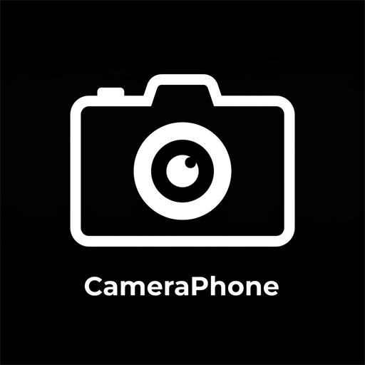

<div align="center">



# 📱🎥 CameraPhone 4K Pro — 4K60/120 HDR10 Studio Camera for PC

**Turn your Android smartphone into a 4K60/120 FPS 10-bit HDR studio camera for NVIDIA Broadcast, OBS Studio, Discord, Zoom & Twitch.**  
*100% Free & Open-Source • Zero Watermarks • Native NVIDIA Broadcast DirectShow Camera • Zero-Config USB & Wi-Fi Auto-Discovery • Native OBS Studio Plugin • Zero-Trust Security*

[](https://github.com/ViniciusCostaGrillo/cameraphone/releases/tag/v1.4.0)
[](https://viniciuscostagrillo.github.io/cameraphone/)
[](https://github.com/ViniciusCostaGrillo/cameraphone/releases/download/v1.4.0/CameraPhone-Setup.exe)
[](https://github.com/ViniciusCostaGrillo/cameraphone/releases/download/v1.4.0/cameraphone-vcam.dll)
[-3DDC84?style=for-the-badge&logo=android&logoColor=white)](https://github.com/ViniciusCostaGrillo/cameraphone/releases/download/v1.4.0/CameraPhone.apk)
[](obs-plugin/)
[](android-app/)
[](https://ko-fi.com/viniciuscostagrillo)

### 🌐 [**Live Project Website**](https://viniciuscostagrillo.github.io/cameraphone/) • [🇺🇸 **English Documentation**](#-cameraphone-4k-pro--english) • [🇧🇷 **Documentação em Português**](#-cameraphone-4k-pro--português-brasil)

[🚀 **Download Windows Setup (`CameraPhone-Setup.exe`)**](https://github.com/ViniciusCostaGrillo/cameraphone/releases/download/v1.4.0/CameraPhone-Setup.exe) • [🤖 **Android App (`CameraPhone.apk`)**](https://github.com/ViniciusCostaGrillo/cameraphone/releases/download/v1.4.0/CameraPhone.apk) • [🖥️ **Desktop Companion (`CameraPhone.exe`)**](https://github.com/ViniciusCostaGrillo/cameraphone/releases/download/v1.4.0/CameraPhone.exe) • [🔌 **OBS Plugin (`cameraphone.dll`)**](https://github.com/ViniciusCostaGrillo/cameraphone/releases/download/v1.4.0/cameraphone.dll) • [🎥 **NVIDIA VCam (`cameraphone-vcam.dll`)**](https://github.com/ViniciusCostaGrillo/cameraphone/releases/download/v1.4.0/cameraphone-vcam.dll)

</div>

---

# 🇺🇸 CameraPhone 4K Pro — English

## 📑 Table of Contents
1. [Why CameraPhone 4K Pro?](#-why-cameraphone-4k-pro)
2. [Native NVIDIA Broadcast Support (USB & Wi-Fi)](#-native-nvidia-broadcast-support-usb--wi-fi)
3. [Native OBS Studio Plugin & Canvas Transforms](#-native-obs-studio-plugin--canvas-transforms)
4. [Zero-Config USB & Automatic Wi-Fi Discovery](#-zero-config-usb--automatic-wi-fi-discovery)
5. [Zero-Trust Security Architecture](#-zero-trust-security-architecture)
6. [Desktop Companion & One-Click Installer](#-desktop-companion--one-click-installer)
7. [Official Binary Downloads (`v1.4.0`)](#-official-binary-downloads-v140)
8. [Building from Source & Running Tests](#-building-from-source--running-tests)

---

## 🎯 Why CameraPhone 4K Pro?

Most smartphone webcam apps lock 4K resolution, 60 FPS, manual ISO/shutter controls, or watermark-free video behind monthly subscriptions, while exposing unauthenticated ports on your local network or crashing **NVIDIA Broadcast** when switching to 4K UHD.

**CameraPhone 4K Pro** was engineered from scratch (*clean-room* C++20 + Kotlin) to give creators, streamers, and professionals an uncompromising, 100% free studio camera pipeline:

| Feature / Capability | ❌ Legacy Apps (DroidCam / EpocCam / Iriun) | ✅ CameraPhone 4K Pro |
| :--- | :--- | :--- |
| **4K UHD (`3840x2160`) Resolution** | Locked behind paid Pro subscription | **100% Free & Native** via `CameraCharacteristics` negotiation |
| **Frame Rates (FPS)** | Capped at 30 FPS (or paid 60 FPS) | **24 / 30 / 60 / 120 FPS High-Speed** (sensor-dependent) |
| **Hardware Video Codecs** | Legacy MJPEG / H.264 only | **`HEVC (H.265)`**, **`AV1`**, and **`AVC (H.264)`** Zero-Copy `Surface` (up to 150 Mbps) |
| **10-bit HDR (`HLG10` / `HDR10`)** | 8-bit SDR only | **Native 10-bit `BT.2020` (`P010` / `I010`)** on Android 13+ |
| **NVIDIA Broadcast Compatibility** | Incompatible or crashes on 4K NV12 pins | **Native DirectShow COM Virtual Camera** (`cameraphone-vcam.dll`) with 4K NV12 support |
| **USB + Wi-Fi for NVIDIA Broadcast** | Requires manual IP/port tweaking | **Hybrid Auto-Discovery:** Plug in USB or open on Wi-Fi — streams automatically |
| **All Physical Camera Lenses** | Basic front/back toggle | **Probes all physical lenses** (Ultra-Wide 13mm, Main 24mm, Telephoto 3x/5x/10x, Front) |
| **Pro Manual Controls** | Locked behind paywall (`HTTP 550`) | **100% Unlocked:** Optical/Hybrid Zoom, ISO, Shutter Speed, EV, White Balance (Kelvin), Torch |
| **Watermarks & Ads** | Injects watermarks after a few minutes | **Zero watermarks, zero ads, zero telemetry** |
| **Language Support** | Fixed | **English (Default) & Portuguese (PT-BR)** with instant `Language` toggle button |
| **License & Cost** | Paid / Subscription | **100% Free & Open-Source** |

---

## 🌟 Native NVIDIA Broadcast Support (USB & Wi-Fi)

**CameraPhone 4K Pro** ships with a custom 64-bit DirectShow COM Virtual Camera filter (`cameraphone-vcam.dll`) specifically engineered for **NVIDIA Broadcast**'s RTX Tensor Core pipeline:

```
[ Android Smartphone ]  ---(HEVC / AV1 @ 60 FPS via USB or Wi-Fi)---> [ CameraPhone Companion / OBS ]
                                                                                     │
                                                                    (Zero-Copy Shared Memory IPC NV12 < 0.8ms)
                                                                                     ▼
                                                                        [ cameraphone-vcam.dll ]
                                                                        (CLSID_VideoInputDeviceCategory)
                                                                                     │
                                                                                     ▼
                                                                        [ NVIDIA Broadcast (RTX AI) ]
                                                                        ├── Background Blur / Removal / Replacement
                                                                        ├── Auto Frame (AI Face Tracking)
                                                                        ├── Eye Contact
                                                                        └── Video Noise Removal
                                                                                     │
                                                                                     ▼
                                                           [ OBS Studio / Discord / Zoom / Teams / Google Meet ]
```

### Key Virtual Camera Highlights
- **Instant Detection in NVIDIA Broadcast:** Registered under `CLSID_VideoInputDeviceCategory` (`{860BB310-5D01-11d0-BD3B-00A0C911CE86}`) exposing `PIN_CATEGORY_CAPTURE` via `IKsPropertySet` and `IAMStreamConfig` with 8 formats up to **4K UHD (`3840x2160`)**.
- **Native NV12 Memory Layout:** Delivers frames in the exact `MEDIASUBTYPE_NV12` layout expected by `NvBroadcastCore.dll`, with full 4K (`16.58 MB`) sample buffer preservation across `SetFormat` -> `Connect(nullptr)` negotiation.
- **60 FPS Procedural Standby Signal:** When the phone is disconnected, the virtual camera outputs a smooth 60 FPS dark slate standby frame so NVIDIA Broadcast never freezes or drops your camera selection.
- **Works Standalone (Without OBS):** The lightweight background service in `CameraPhone.exe` automatically feeds `CameraPhone Virtual Camera` over **USB Cable** or **Wi-Fi** even when OBS Studio is closed.

---

## 📐 Native OBS Studio Plugin & Canvas Transforms

Adding the **`CameraPhone 4K Pro (USB Cable / Wi-Fi IP)`** source in OBS Studio gives you a native async video/audio source (`ABI v30`) with full canvas transform support:

- **Dynamic Bounding Box & Free Resizing:** Reports real-time decoded dimensions (`source_get_width` / `source_get_height`) so you can drag red canvas handles to resize, rotate, or snap to screen edges.
- **Pixel-Accurate `Alt`-Cropping:** Hold `Alt` and drag any edge in the OBS preview canvas to crop your framing.
- **Full OBS Filter Compatibility:** Works seamlessly with Image Mask/Blend, Chroma Key, LUTs, Color Correction, and Shader filters.

---

## 🚀 Zero-Config USB & Automatic Wi-Fi Discovery

### 1. USB Cable Mode (`Zero-Config Plug & Play`)
1. Connect your Android phone to your PC via USB with **USB Debugging** enabled.
2. Run `CameraPhone-Setup.exe` (or open `CameraPhone.exe`) and click **`2. Install APK on Phone`**.
3. The app is automatically installed, permissions (`CAMERA` + `RECORD_AUDIO`) are granted, the ADB tunnel (`127.0.0.1:4748`) is established, and video immediately starts streaming to **NVIDIA Broadcast** and **OBS Studio**!

### 2. Automatic Wi-Fi Mode (`Zero-Config LAN`)
1. Once the APK is installed on your phone, simply connect your phone and PC to the **same Wi-Fi network**.
2. Unplug the USB cable and open the **CameraPhone** app on your phone.
3. `CameraPhone.exe` automatically discovers your phone on the local network (via cached `wlan0` IP, UDP beacon on port `4749`, or fast non-blocking `/24` subnet scan on port `4748`) and streams directly to **NVIDIA Broadcast** and **OBS Studio** over Wi-Fi — **no IP or PIN typing required**!

---

## 🛡️ Zero-Trust Security Architecture

- **Constant-Time Token Verification:** Requests are verified via `SecurityGate` using constant-time comparison (`MessageDigest.isEqual`).
- **Private LAN Zero-Config + WAN Protection:** Automatic `usb-zero-config` authentication is strictly restricted to loopback (`127.0.0.1`) and RFC1918 private LAN subnets (`192.168.*`, `10.*`, `172.16-31.*`). Any public/external IP is rejected (`HTTP 401`) and rate-limited (`HTTP 429` after 5 failed attempts).
- **USB-Only Hardware Lock Switch:** A single toggle in the Android app (`Block Wi-Fi (Allow USB Cable Only)`) binds the server exclusively to `127.0.0.1` for maximum physical security.

---

## 🎛️ Desktop Companion & One-Click Installer

Both the Desktop Companion (`CameraPhone.exe`), the Windows Installer (`CameraPhone-Setup.exe`), and the Android App (`CameraPhone.apk`) default to **English (`EN`)** and feature a **`Language: EN / PT`** button in the top-right corner to switch between English and Portuguese at any time:

```
+---------------------------------------------------------------------------------------+
|  CameraPhone 4K Pro                                                  [ Language: EN ] |
|  NVIDIA Broadcast Virtual Camera & OBS Zero-Config Plugin                             |
+---------------------------------------------------------------------------------------+
| [1. Install All (OBS + VCam)] [2. Install APK on Phone] [3. Test Connection] [4. Logs]|
+---------------------------------------------------------------------------------------+
| REAL-TIME DIAGNOSTIC CONSOLE                                                          |
| ┌───────────────────────────────────────────────────────────────────────────────────┐ |
| │ [ZERO-CONFIG INSTALLED SUCCESSFULLY]                                              │ |
| │   * OBS Plugin: C:\Program Files\obs-studio\obs-plugins\64bit\cameraphone.dll     │ |
| │   * Virtual Camera: CameraPhone Virtual Camera registered (NVIDIA Broadcast ready)│ |
| │   * ADB Driver & APK updated for plug-and-play USB & Wi-Fi streaming.             │ |
| │ [System] Automatic USB & Wi-Fi streaming to CameraPhone Virtual Camera started.   │ |
| └───────────────────────────────────────────────────────────────────────────────────┘ |
+---------------------------------------------------------------------------------------+
```

---

## 📦 Official Binary Downloads (`v1.4.0`)

All pre-compiled, standalone binaries are available on the [GitHub Releases](https://github.com/ViniciusCostaGrillo/cameraphone/releases/tag/v1.4.0) page:

| File | Size | Description | Direct Download |
| :--- | :---: | :--- | :---: |
| 🚀 **`CameraPhone-Setup.exe`** | 8.3 MB | **Full Windows Setup Installer** (Installs OBS plugin, NVIDIA Broadcast VCam, ADB, shortcuts, autostart & `Uninstall-CameraPhone.exe`) | [Download Setup](https://github.com/ViniciusCostaGrillo/cameraphone/releases/download/v1.4.0/CameraPhone-Setup.exe) |
| 🖥️ **`CameraPhone.exe`** | 1.8 MB | **Standalone Desktop Companion & Hybrid USB/Wi-Fi VCam Feeder** | [Download EXE](https://github.com/ViniciusCostaGrillo/cameraphone/releases/download/v1.4.0/CameraPhone.exe) |
| 📱 **`CameraPhone.apk`** | 865 KB | **Signed Android App** (Auto-connects via USB & Wi-Fi LAN, OLED blackout mode, EN/PT toggle) | [Download APK](https://github.com/ViniciusCostaGrillo/cameraphone/releases/download/v1.4.0/CameraPhone.apk) |
| 🔌 **`cameraphone.dll`** | 1.7 MB | **Native 64-bit OBS Studio Plugin** (`C:\Program Files\obs-studio\obs-plugins\64bit`) | [Download DLL](https://github.com/ViniciusCostaGrillo/cameraphone/releases/download/v1.4.0/cameraphone.dll) |
| 🎥 **`cameraphone-vcam.dll`** | 838 KB | **DirectShow 4K60 Virtual Camera for NVIDIA Broadcast** | [Download VCam](https://github.com/ViniciusCostaGrillo/cameraphone/releases/download/v1.4.0/cameraphone-vcam.dll) |

---

## 🧪 Building from Source & Running Tests

```powershell
# 1. C++20 Wire Protocol & Shared Memory IPC Unit Tests
python protocol/run_tests.py

# 2. Android JVM Unit Tests (SecurityGate, CamPhonePacket, CapabilityProbe)
python android-app/build_and_test.py test

# 3. Build & Sign Android APK (CameraPhone.apk)
python android-app/build_and_test.py assembleDebug

# 4. Build OBS Plugin (cameraphone.dll), VCam (cameraphone-vcam.dll) & Companion (CameraPhone.exe)
python obs-plugin/build_plugin.py

# 5. Build Windows Setup Installer (CameraPhone-Setup.exe)
python installer/build_installer.py

# 6. Run Full End-to-End Runtime Artifact Verification Suite
python tools/verify_artifacts_runtime.py
```

---
---

# 🇧🇷 CameraPhone 4K Pro — Português (Brasil)

## 📑 Sumário Executivo
1. [Por que o CameraPhone existe?](#-por-que-o-cameraphone-existe)
2. [Compatibilidade com NVIDIA Broadcast (Cabo USB e Wi-Fi)](#-compatibilidade-com-nvidia-broadcast-cabo-usb-e-wi-fi)
3. [Transformações Livres no OBS Studio](#-transformações-livres-no-obs-studio)
4. [Conexão Automática via Cabo USB e Wi-Fi Zero-Config](#-conexão-automática-via-cabo-usb-e-wi-fi-zero-config)
5. [Central Desktop & Alternância de Idioma (`EN / PT`)](#-central-desktop--alternância-de-idioma-en--pt)
6. [Tabela de Downloads (`v1.4.0`)](#-tabela-de-downloads-v140)

---

## 🎯 Por que o CameraPhone existe?

O **CameraPhone 4K Pro** transforma seu smartphone Android em uma câmera de estúdio **4K60/120 FPS HDR 10-bit** para o PC, **100% gratuito, código aberto e sem marca d'água**.

| Recurso / Critério | ❌ Soluções Tradicionais (DroidCam / EpocCam) | ✅ CameraPhone 4K Pro |
| :--- | :--- | :--- |
| **Resolução 4K UHD (`3840x2160`)** | Bloqueada atrás de assinatura paga | **100% Liberada Nativamente** |
| **Taxas de Quadros (FPS)** | 30 / 60 FPS fixos | **24 / 30 / 60 / 120 FPS High-Speed** |
| **Codecs em Hardware** | Apenas AVC (H.264) e MJPEG legado | **`HEVC (H.265)`**, **`AV1`** e **`AVC (H.264)`** Zero-Copy via `Surface` |
| **NVIDIA Broadcast (USB e Wi-Fi)** | Incompatível ou trava em 4K | **Driver DirectShow COM Nativo** (`cameraphone-vcam.dll`) via Cabo USB e Wi-Fi |
| **Lentes Físicas Múltiplas** | Apenas genéricas (traseira/frontal) | **Todas as lentes reais** (Ultra-Wide, Wide, Telefoto, Frontal) |
| **Idiomas** | Fixo | **Inglês (Padrão) e Português** com botão **`Language: EN / PT`** |
| **Custo** | Pago / Assinatura | **100% Gratuito & Open-Source** |

---

## 🌟 Compatibilidade com NVIDIA Broadcast (Cabo USB e Wi-Fi)

O driver DirectShow [`cameraphone-vcam.dll`](dist/cameraphone-vcam.dll) registra a **`CameraPhone Virtual Camera`** no Windows com suporte nativo a **NV12 até 4K UHD (`3840x2160`)**:
- Funciona **tanto pelo Cabo USB quanto pelo Wi-Fi** automaticamente através do `CameraPhone.exe` em segundo plano, sem precisar que o OBS Studio esteja aberto.
- Compatível com todos os efeitos de IA RTX do **NVIDIA Broadcast** (Remoção/Desfoque de Fundo, Auto-Framing, Eye Contact e Redução de Ruído).

---

## 📐 Transformações Livres no OBS Studio

A fonte **`CameraPhone 4K Pro (USB Cable / Wi-Fi IP)`** no OBS Studio oferece:
- **Redimensionamento livre** pelas alças vermelhas da tela.
- **Recorte com `Alt`** arrastando qualquer borda.
- **Suporte total a filtros** (Máscaras, Chroma Key, LUTs e Correção de Cor).

---

## 🚀 Conexão Automática via Cabo USB e Wi-Fi Zero-Config

1. **Via Cabo USB:** Conecte o celular com *Depuração USB* ativa e clique em **`2. Install APK on Phone`** (ou `2. Instalar APK no Celular`). O vídeo inicia automaticamente!
2. **Via Wi-Fi Automático:** Com o APK atualizado instalado no celular, basta estar na mesma rede Wi-Fi do PC. Mesmo desconectando o cabo USB, o `CameraPhone.exe` descobre o celular automaticamente na Wi-Fi e continua transmitindo para o **NVIDIA Broadcast** e **OBS Studio** sem precisar digitar IP ou PIN!

---

## 🎛️ Central Desktop & Alternância de Idioma (`EN / PT`)

Todos os aplicativos (Instalador `CameraPhone-Setup.exe`, Companion `CameraPhone.exe` e App Android `CameraPhone.apk`) iniciam por padrão em **Inglês (`EN`)** e possuem o botão **`Language: EN / PT`** no canto superior direito para alternar instantaneamente para **Português (`PT`)**.

---

## 📦 Tabela de Downloads (`v1.4.0`)

| Arquivo | Tamanho | Descrição | Download Direto |
| :--- | :---: | :--- | :---: |
| 🚀 **`CameraPhone-Setup.exe`** | 8.3 MB | **Instalador Completo do Windows** (Plugin OBS, Câmera Virtual NVIDIA Broadcast, ADB, Atalhos e Desinstalador) | [Baixar Instalador](https://github.com/ViniciusCostaGrillo/cameraphone/releases/download/v1.4.0/CameraPhone-Setup.exe) |
| 🖥️ **`CameraPhone.exe`** | 1.8 MB | **Companion Desktop & Alimentador Automático USB/Wi-Fi da VCam** | [Baixar EXE](https://github.com/ViniciusCostaGrillo/cameraphone/releases/download/v1.4.0/CameraPhone.exe) |
| 📱 **`CameraPhone.apk`** | 865 KB | **Aplicativo Android Oficial Assinado** (Zero-Config USB & Wi-Fi, botão Language EN/PT) | [Baixar APK](https://github.com/ViniciusCostaGrillo/cameraphone/releases/download/v1.4.0/CameraPhone.apk) |
| 🔌 **`cameraphone.dll`** | 1.7 MB | **Plugin Nativo OBS Studio 64-bit** | [Baixar DLL](https://github.com/ViniciusCostaGrillo/cameraphone/releases/download/v1.4.0/cameraphone.dll) |
| 🎥 **`cameraphone-vcam.dll`** | 838 KB | **Câmera Virtual DirectShow 4K60 para NVIDIA Broadcast** | [Baixar VCam](https://github.com/ViniciusCostaGrillo/cameraphone/releases/download/v1.4.0/cameraphone-vcam.dll) |

---

<div align="center">

Built for creators, streamers, and video engineers worldwide.  
**[🌐 Website](https://viniciuscostagrillo.github.io/cameraphone/) • [📦 Releases](https://github.com/ViniciusCostaGrillo/cameraphone/releases)**

</div>
