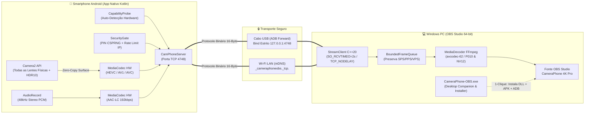

<div align="center">

# 📱🎥 CameraPhone OBS — 4K60/120 HDR10 Pro

**Transforme seu smartphone Android em uma câmera de estúdio 4K60/120 FPS HDR 10-bit para o OBS Studio.**  
*100% Gratuito • Zero Marca D'água • Segurança Zero-Trust Anti-Hacker • Arquitetura Zero-Freeze*

[](https://obsproject.com/)
[-3DDC84?style=for-the-badge&logo=android&logoColor=white)](dist/CameraPhone-OBS.apk)
[](obs-plugin/)
[](android-app/)
[](docs/superpowers/specs/2026-11-04-cameraphone-obs-design.md)

[📦 **Baixar Executável Windows (.exe)**](dist/CameraPhone-OBS.exe) • [🤖 **Baixar App Android (.apk)**](dist/CameraPhone-OBS.apk) • [🔌 **Baixar Plugin OBS (.dll)**](dist/cameraphone-obs.dll) • [🔬 **Relatório de Engenharia Reversa**](docs/droidcam-reverse-engineering.md)

</div>

---

## 🎯 Por que o CameraPhone OBS existe?

Durante a engenharia reversa completa do plugin proprietário **DroidCam OBS** ([leia o relatório técnico completo aqui](docs/droidcam-reverse-engineering.md)), identificamos limitações severas de arquitetura, qualidade e segurança:

| Recurso / Critério | ❌ DroidCam OBS (Original) | ✅ CameraPhone OBS (Este Projeto) |
| :--- | :--- | :--- |
| **Resolução 4K UHD (`3840x2160`)** | Escondida atrás de um *Easter Egg* (`"4K"` digitado no campo IP) e bloqueada por paywall | **Liberada nativamente** via inspeção automática do sensor (`CameraCharacteristics`) |
| **Taxa de Quadros (FPS)** | Limitada a 30/60 FPS fixos | **24 / 30 / 60 / 120 FPS High-Speed** (baseado na capacidade real do hardware) |
| **Codecs de Vídeo em Hardware** | `AVC (H.264)` e `MJPEG` legado | **`HEVC (H.265)`**, **`AV1`** e **`AVC (H.264)`** Zero-Copy via `Surface` (até 150 Mbps) |
| **HDR 10-bit (`HLG10` / `HDR10`)** | Não suportado (apenas 8-bit SDR) | **Suporte nativo a 10-bit `BT.2020` (`P010`)** no Android 13+ |
| **Lentes Físicas Múltiplas** | Genéricas, sem distância focal real | **Descoberta automática de todas as lentes físicas** (Ultra-Wide 13mm, Wide 24mm, Telefoto 3x/5x/10x, Frontal) |
| **Controles Pro no OBS Studio** | Bloqueados com erro `HTTP 550` na versão gratuita | **100% liberados na UI do OBS:** Zoom Óptico/Híbrido, ISO, Obturador, EV, Balanço de Branco (Kelvin) e Lanterna |
| **Marca D'água (`SetOverlayText`)** | Injetada nos quadros após alguns minutos | **Zero marca d'água** — pipeline de vídeo 100% limpo |
| **Segurança de Rede (Anti-Hacker)** | Servidor HTTP aberto em `0.0.0.0:4747` **sem senha** (qualquer pessoa no Wi-Fi pode espionar câmera/microfone) | **Zero-Trust:** PIN de 6 dígitos CSPRNG, comparação em tempo constante, bloqueio de IP contra força bruta e bind estrito em `127.0.0.1` no modo Cabo USB |

---

## 🏗️ Arquitetura do Sistema (`CamPhoneWire v1`)

O sistema foi desenhado sob três pilares: **Qualidade Máxima de Hardware**, **Segurança Zero-Trust** e **Estabilidade Zero-Freeze** (a interface do OBS Studio jamais trava mesmo se o cabo USB for desconectado abruptamente).



### Protocolo Binário `CamPhoneWire v1` (Cabeçalho de 16 Bytes Big-Endian)

Cada pacote de vídeo, áudio ou metadados trafega em socket TCP dedicado (`TCP_NODELAY = 1`) com cabeçalho compacto de 16 bytes e limite rígido de segurança de `8 MiB` por pacote (proteção contra ataques de exaustão de memória / DoS):

```text
 0                   1                   2                   3
 0 1 2 3 4 5 6 7 8 9 0 1 2 3 4 5 6 7 8 9 0 1 2 3 4 5 6 7 8 9 0 1
+-+-+-+-+-+-+-+-+-+-+-+-+-+-+-+-+-+-+-+-+-+-+-+-+-+-+-+-+-+-+-+-+
|         Magic (0x4350)        |  Version (1)  |  StreamType   |
+-+-+-+-+-+-+-+-+-+-+-+-+-+-+-+-+-+-+-+-+-+-+-+-+-+-+-+-+-+-+-+-+
|                                                               |
+                     PTS Microseconds (64-bit)                 +
|                                                               |
+-+-+-+-+-+-+-+-+-+-+-+-+-+-+-+-+-+-+-+-+-+-+-+-+-+-+-+-+-+-+-+-+
|     Flags     |              Payload Size (24-bit)            |
+-+-+-+-+-+-+-+-+-+-+-+-+-+-+-+-+-+-+-+-+-+-+-+-+-+-+-+-+-+-+-+-+
|                         Payload Bytes ...                     |
+-+-+-+-+-+-+-+-+-+-+-+-+-+-+-+-+-+-+-+-+-+-+-+-+-+-+-+-+-+-+-+-+
```

---

## 🛡️ Segurança Extrema (Zero-Trust Anti-Hacker)

1. **PIN Criptográfico de 6 Dígitos (`SecureRandom`):** Gerado dinamicamente no celular a cada sessão, com botão para rotacionar o PIN e derrubar conexões imediatamente.
2. **Verificação em Tempo Constante:** Tanto no Android (`MessageDigest.isEqual`) quanto no C++20 (`constant_time_equals`), o token `Bearer <PIN>` é validado sem vazamento de tempo (*timing side-channel resistant*).
3. **Proteção Anti-Brute-Force por IP:** Após **5 tentativas incorretas**, o endereço IP atacante é bloqueado automaticamente por **60 segundos** (`HTTP 429 Too Many Requests`).
4. **Isolamento Físico no Modo Cabo USB (`127.0.0.1`):** Quando a chave *"Modo Exclusivo Cabo USB"* está ativa no app Android, o socket faz bind estrito na interface de loopback `127.0.0.1:4748`. Mesmo conectado a um Wi-Fi público, **nenhum dispositivo na rede consegue enxergar ou conectar à porta do celular**.
5. **Prevenção de Command Injection e Overflow:**
   - Seriais ADB passam por validação de allowlist estrita (`[a-zA-Z0-9._:-]`).
   - Todos os comandos de câmera (`zoom`, `iso`, `shutterNs`, `ev`, `wbKelvin`, `focus`) recebidos pelo celular são forçados dentro dos limites físicos reais do sensor (`SecurityGate.sanitizeControlPatch`).

---

## 🚀 Instalação Rápida (3 Passos)

Todos os binários compilados e assinados já estão prontos na pasta [`dist/`](dist/) e na raiz do repositório:

| Arquivo | Tamanho | Descrição |
| :--- | :---: | :--- |
| [`dist/CameraPhone-OBS.exe`](dist/CameraPhone-OBS.exe) | `1.62 MB` | **Desktop Companion & Instalador 1-Clique** para Windows |
| [`dist/CameraPhone-OBS.apk`](dist/CameraPhone-OBS.apk) | `848 KB` | **Aplicativo Android Nativo** (assinado com esquemas v1/v2/v3) |
| [`dist/cameraphone-obs.dll`](dist/cameraphone-obs.dll) | `1.49 MB` | **Plugin Nativo 64-bit** para OBS Studio v30+ |

### Opção A — Usando o Instalador Gráfico (`CameraPhone-OBS.exe`)
1. Conecte seu celular Android ao PC via cabo USB com a **Depuração USB** ativada.
2. Abra o executável [`CameraPhone-OBS.exe`](CameraPhone-OBS.exe).
3. Clique em **"1. Instalar Plugin no OBS"** (copia automaticamente a `.dll` para `C:\Program Files\obs-studio\obs-plugins\64bit`).
4. Clique em **"2. Ativar USB ADB + APK"** (instala o `CameraPhone-OBS.apk` no celular e cria o túnel `127.0.0.1:4748`).
5. Abra o app **CameraPhone OBS** no celular, veja o **PIN de 6 dígitos** e adicione a fonte **CameraPhone 4K Pro (USB / Wi-Fi)** dentro do OBS Studio!

### Opção B — Instalação via PowerShell
```powershell
# Instala o plugin no OBS Studio e (se houver celular conectado em USB) instala o APK e ativa o túnel ADB:
.\install.ps1
```

---

## ✨ Interface Minimalista OLED Dark no Android

O aplicativo Android foi projetado especificamente para transmissões longas sem aquecimento ou drenagem desnecessária de bateria:
- **Fundo Preto Carbono OLED (`#0D0F12`):** Sem preview redundante de câmera na tela do celular quando você já está monitorando pelo OBS no PC.
- **Indicador Tally Light de Estúdio:**
  - 🔴 **`NO AR (OBS PROGRAM ATIVO)`** quando a câmera está ao vivo na cena principal do OBS.
  - 🟢 **`EM PREVIEW NO OBS`** quando a câmera está apenas em preparação.
- **Modo Tela Preta OLED (Blackout):** Botão dedicado que apaga 100% dos pixels da tela OLED mantendo o hardware de captura 4K60 ativo (basta um **duplo toque** na tela para voltar).

---

## 📂 Estrutura de Diretórios

```text
cameraphone-obs/
├── CameraPhone-OBS.exe                  # App Desktop Windows & Instalador 1-Clique
├── CameraPhone-OBS.apk                  # App Android compilado e assinado (v1/v2/v3)
├── install.ps1                          # Script PowerShell de instalação automática
├── dist/                                # Binários prontos para distribuição (.exe, .apk, .dll)
├── protocol/                            # Protocolo CamPhoneWire v1 (C++20 header-only + testes)
│   ├── camphone_protocol.hpp
│   ├── test_protocol.cpp
│   └── run_tests.py
├── android-app/                         # App Android Nativo em Kotlin (Camera2 + MediaCodec)
│   ├── build_and_test.py
│   └── app/src/main/java/com/cameraphone/obs/
│       ├── camera/                      # Camera2Controller, HardwareVideoEncoder, HardwareAudioEncoder
│       ├── net/                         # CamPhoneServer (HTTP Control + Binary Stream Socket)
│       ├── probe/                       # CapabilityProbe (Auto-detecção 4K/120fps/HDR10/Lentes)
│       ├── protocol/                    # CamPhonePacket (Framing Big-Endian 16 bytes)
│       ├── security/                    # SecurityGate (PIN CSPRNG, Rate-Limit IP, Bounds Clamping)
│       ├── service/                     # CameraStreamService (ForegroundService + mDNS NsdManager)
│       └── ui/                          # MainActivity (Interface Minimalista OLED Dark + Tally)
├── obs-plugin/                          # Plugin Nativo C++20 64-bit para OBS Studio
│   ├── CMakeLists.txt
│   ├── build_plugin.py
│   ├── src/                             # plugin-main, cameraphone-source, stream-client, media-decoder, discovery-manager
│   └── tests/                           # Testes C++20 de segurança ADB e parser de capacidades
├── desktop-app/                         # Código-fonte C++20 Win32 do CameraPhone-OBS.exe
│   └── cameraphone_companion.cpp
├── tools/                               # Verificadores automatizados E2E e Runtime
│   ├── verify_e2e_stream.py
│   └── verify_artifacts_runtime.py
└── docs/                                # Documentação de Engenharia Reversa e Arquitetura
    ├── droidcam-reverse-engineering.md
    └── superpowers/
        ├── specs/2026-11-04-cameraphone-obs-design.md
        └── plans/2026-11-04-cameraphone-obs-plan.md
```

---

## 🧪 Como Compilar e Rodar a Suíte de Testes

Todo o projeto foi construído seguindo **Test-Driven Development (TDD)** e conta com verificadores automatizados de ponta a ponta:

```powershell
# 1. Testes Unitários C++20 do Protocolo CamPhoneWire v1 e Segurança
python protocol/run_tests.py

# 2. Testes Unitários JUnit4 do App Android (SecurityGate, CamPhonePacket, CapabilityProbe, CamPhoneServer)
python android-app/build_and_test.py test

# 3. Compilar o APK Android assinado do zero
python android-app/build_and_test.py assembleDebug

# 4. Testes C++20 e Compilação do Plugin OBS (.dll) + App Desktop (.exe)
python obs-plugin/build_plugin.py all

# 5. Teste de Integração End-to-End (Handshake Bearer PIN, Rate-Limit, Patch de Controle e Stream Binário)
python tools/verify_e2e_stream.py

# 6. Verificação Dinâmica em Tempo de Execução dos Binários (.dll via WinDLL, .exe GUI/CLI e .apk DEX/Assinaturas)
python tools/verify_artifacts_runtime.py
```

---

<div align="center">

Desenvolvido com foco em **Performance Nativa**, **Segurança Zero-Trust** e **Qualidade de Imagem Máxima**.

</div>
