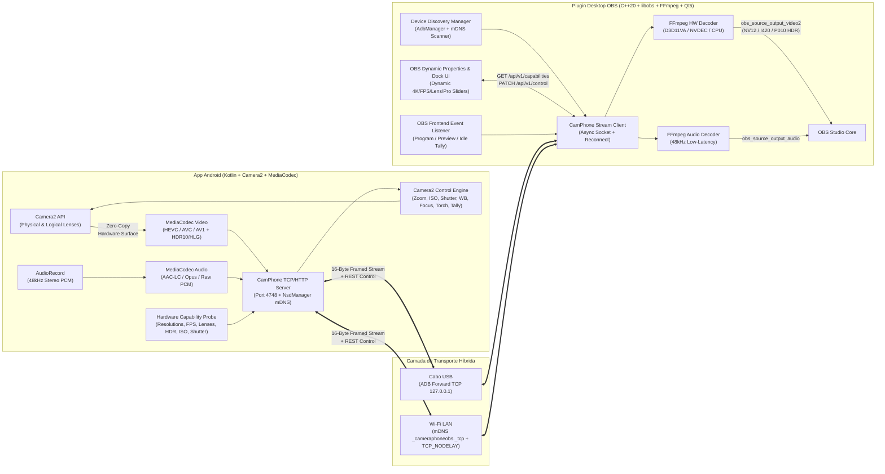

# Especificação de Design: Cameraphone Plugin OBS (4K / 60+ FPS / HDR / Pro Controls)

> [!NOTE]
> Este documento define a arquitetura limpa (*clean-room*) do **Cameraphone Plugin OBS**, projetada a partir das descobertas da nossa engenharia reversa do DroidCam OBS ([`droidcam_reverse_engineering.md`](file:///C:/Users/Vinic/.gemini/antigravity/brain/81366343-3009-43bd-9352-50199e327ea4/droidcam_reverse_engineering.md)), eliminando todos os gargalos e limitações artificiais encontrados.

---

## 1. Abordagens Arquiteturais Avaliadas

Avaliamos **3 arquiteturas possíveis** para o transporte, negociação de hardware e pipeline de mídia entre o Android e o OBS Studio:

### Opção A (Recomendada): Protocolo Binário Multiplexado sobre TCP (`CamPhoneWire v1`) + Controle JSON Bidirecional + Zero-Copy Surface Pipeline
- **Como funciona:**
  - **Descoberta:** mDNS (`_cameraphoneobs._tcp.local.`) na rede Wi-Fi e túnel automático `adb forward tcp:<local> tcp:4748` via USB.
  - **Negociação de Hardware Dinâmica:** Ao conectar na porta `4748`, o plugin OBS requisita o manifesto de capacidades (`GET /api/v1/capabilities`), que interroga em tempo real a API `Camera2` (`CameraCharacteristics` + lentes físicas de câmeras multi-sensor) e o `MediaCodecList` do SoC do celular.
  - **Transporte de Mídia & Controle:** Usa framing binário ultra-leve de **16 bytes** (`magic`, `stream_type` [Vídeo/Áudio/Telemetria/Config], `flags` [Keyframe/HDR/Config], `pts_ns`, `payload_len`) com `TCP_NODELAY` ativado.
  - **Pipeline Android:** `Camera2` escreve diretamente na `Surface` de hardware do `MediaCodec` (`COLOR_FormatSurface`, zero cópias de CPU no celular), codificando em **HEVC (H.265)**, **AVC (H.264)** ou **AV1** (10-bit HLG/HDR10 ou 8-bit SDR) com bitrate configurável até **150 Mbps** via USB.
- **Vantagens:** Funciona perfeitamente tanto em Cabo USB (`adb forward` só transporta TCP) quanto em Wi-Fi; latência sub-frame (~15–30 ms via USB); zero perda de pacotes/artefatos de blocos; descoberta 100% dinâmica das capacidades máximas do aparelho.

### Opção B: WebRTC Nativo (UDP/RTP + SDP Signalling)
- **Prós:** Padrão de mercado para chamadas em tempo real com controle automático de congestionamento.
- **Contras:** A biblioteca `libwebrtc` adiciona >40 MB ao binário, **degrada agressivamente a resolução/bitrate** ao menor sinal de jitter, não funciona nativamente sobre `adb forward` (que é apenas TCP) sem STUN/TURN local em TCP, e dificulta o transporte de HEVC 10-bit / AV1 de alto bitrate (100+ Mbps).

### Opção C: RTSP / SRT sobre FFmpeg `libavformat`
- **Prós:** Fácil integração com players externos (VLC).
- **Contras:** O demuxer genérico do `libavformat` adiciona buffers internos que elevam a latência para 150–400 ms, além de não possuir canal bidirecional integrado para controle de lentes/ISO/foco/Tally Light.

> [!TIP]
> **Decisão:** Adotaremos a **Opção A (`CamPhoneWire v1`)**, pois entrega qualidade de estúdio (até 4K60/120 HDR em alto bitrate), latência mínima em USB e Wi-Fi, e integração total dos controles Pro diretamente nos painéis do OBS Studio.

---

## 2. Arquitetura do Sistema Ponta a Ponta



---

## 3. Descoberta Dinâmica de Hardware (`GET /api/v1/capabilities`)

Diferente do DroidCam OBS (que possui apenas 7 resoluções fixas no código C++ e esconde o 4K), nosso App Android analisa o hardware real do aparelho na inicialização usando `CameraManager` e `MediaCodecList`:

1. **Enumeração de Lentes Físicas e Lógicas (Android 9+ Multi-Camera API):**
   - Itera sobre `cameraManager.cameraIdList` e `CameraCharacteristics.getPhysicalCameraIds()`.
   - Calcula a distância focal equivalente em 35mm e abertura (`LENS_INFO_AVAILABLE_FOCAL_LENGTHS`, `LENS_INFO_AVAILABLE_APERTURES`, `SENSOR_INFO_PHYSICAL_SIZE`) para rotular automaticamente cada lente no OBS:
     - Ex: `"Traseira Ultra-Wide (0.6x - 13mm f/2.2)"`, `"Traseira Principal (1.0x - 24mm f/1.8 - OIS)"`, `"Traseira Telefoto (3.0x - 72mm f/2.4)"`, `"Frontal (26mm f/2.2)"`.
2. **Interseção Sensor $\cap$ Hardware Encoder (`StreamConfigurationMap` $\cap$ `MediaCodecInfo.VideoCapabilities`):**
   - Lista todas as resoluções suportadas por `MediaCodec::class.java` (`getOutputSizes()` + `getHighSpeedVideoSizes()`) e cruza com `VideoCapabilities.areSizeAndRateSupported(width, height, fps)` para `video/hevc`, `video/avc` e `video/av01`.
   - Detecta taxas de quadros reais por resolução (ex: `3840x2160 @ 60fps`, `3840x2160 @ 30fps`, `2560x1440 @ 60fps`, `1920x1080 @ 120fps`).
3. **Detecção de HDR 10-bit:**
   - Consulta `REQUEST_AVAILABLE_DYNAMIC_RANGE_PROFILES` (`HLG10`, `HDR10`, `HDR10_PLUS`) por câmera.
4. **Faixas de Controles Pro por Câmera:**
   - `CONTROL_ZOOM_RATIO_RANGE` (ex: `0.5x` a `10.0x`)
   - `SENSOR_INFO_SENSITIVITY_RANGE` (ex: ISO `50` a `6400`)
   - `SENSOR_INFO_EXPOSURE_TIME_RANGE` (ex: Shutter `1/8000s` a `1/4s`)
   - `CONTROL_AE_COMPENSATION_RANGE` e `CONTROL_AE_COMPENSATION_STEP` (EV `-3.0` a `+3.0`)
   - `LENS_INFO_MINIMUM_FOCUS_DISTANCE` (`0.0f` = infinito até macro em dioptrias)
   - `FLASH_INFO_AVAILABLE` (Lanterna/Torch disponível)

### Exemplo de Payload `GET /api/v1/capabilities`
```json
{
  "device": {
    "manufacturer": "Samsung",
    "model": "SM-S928B (Galaxy S24 Ultra)",
    "android_version": "14",
    "api_level": 34,
    "battery_pct": 88,
    "charging": true,
    "temp_celsius": 34.5
  },
  "codecs": [
    { "id": "hevc", "mime": "video/hevc", "hw_accelerated": true, "max_bitrate_mbps": 150, "hdr10_supported": true },
    { "id": "avc",  "mime": "video/avc",  "hw_accelerated": true, "max_bitrate_mbps": 100, "hdr10_supported": false },
    { "id": "av1",  "mime": "video/av01", "hw_accelerated": true, "max_bitrate_mbps": 120, "hdr10_supported": true }
  ],
  "cameras": [
    {
      "id": "0",
      "facing": "back",
      "label": "Traseira Principal (24mm f/1.7)",
      "focal_length_mm": 6.3,
      "aperture": 1.7,
      "torch_supported": true,
      "hdr_profiles": ["sdr", "hlg10", "hdr10"],
      "zoom_range": [1.0, 10.0],
      "iso_range": [50, 3200],
      "shutter_ns_range": [40000, 33333333],
      "ev_range": [-20, 20],
      "ev_step": 0.1,
      "min_focus_distance": 10.0,
      " stabilization_modes": ["off", "ois", "eis"],
      "formats": [
        { "width": 3840, "height": 2160, "fps": [24, 30, 60] },
        { "width": 2560, "height": 1440, "fps": [30, 60] },
        { "width": 1920, "height": 1080, "fps": [30, 60, 120] },
        { "width": 1280, "height": 720,  "fps": [30, 60] }
      ]
    }
  ]
}
```

---

## 4. Especificação do Protocolo `CamPhoneWire v1`

### 4.1 Endpoints HTTP de Controle e Stream (Porta `4748`)
- **`GET /api/v1/capabilities`**: Retorna o JSON completo acima com câmeras, resoluções, FPS, codecs e faixas de controles do celular.
- **`GET /api/v1/status`**: Retorna estado atual dos controles + bateria + temperatura + FPS/bitrate real.
- **`PATCH /api/v1/control`**: Atualiza em tempo real qualquer parâmetro da câmera sem interromper o stream (exceto quando muda resolução/codec):
  ```json
  {
    "camera_id": "0",
    "zoom": 1.5,
    "ae_mode": "manual",
    "iso": 200,
    "shutter_ns": 8333333,
    "ev": 0,
    "wb_mode": "manual",
    "wb_kelvin": 5600,
    "af_mode": "manual",
    "focus_distance": 2.5,
    "torch": false,
    "stabilization": "ois",
    "bitrate_bps": 60000000,
    "request_idr": false
  }
  ```
- **`PUT /api/v1/tally`**: `{ "state": "program" | "preview" | "idle" }` (muda a borda luminosa e indicador Tally na tela do celular).
- **`GET /api/v1/stream?camera=0&codec=hevc&width=3840&height=2160&fps=60&bitrate=60000000&hdr=hlg10&audio=aac`**:
  Responde `HTTP/1.1 200 OK\r\nContent-Type: application/x-camphone-stream\r\n\r\n` e faz upgrade imediato do socket TCP para o stream binário multiplexado (Vídeo + Áudio + Telemetria na mesma conexão, evitando dessincronia A/V!).

### 4.2 Cabeçalho Binário de 16 Bytes (`CamPhonePacketHeader`)
Todos os pacotes no stream usam cabeçalho Big-Endian de **16 bytes** alinhado em 64 bits:

```
 0                   1                   2                   3
 0 1 2 3 4 5 6 7 8 9 0 1 2 3 4 5 6 7 8 9 0 1 2 3 4 5 6 7 8 9 0 1
+-+-+-+-+-+-+-+-+-+-+-+-+-+-+-+-+-+-+-+-+-+-+-+-+-+-+-+-+-+-+-+-+
|         Magic (0x4350 = "CP") |  Stream Type  |     Flags     |
+-+-+-+-+-+-+-+-+-+-+-+-+-+-+-+-+-+-+-+-+-+-+-+-+-+-+-+-+-+-+-+-+
|                    Payload Length (32 bits)                   |
+-+-+-+-+-+-+-+-+-+-+-+-+-+-+-+-+-+-+-+-+-+-+-+-+-+-+-+-+-+-+-+-+
|                        PTS (High 32 bits)                     |
+-+-+-+-+-+-+-+-+-+-+-+-+-+-+-+-+-+-+-+-+-+-+-+-+-+-+-+-+-+-+-+-+
|                        PTS (Low 32 bits)                      |
+-+-+-+-+-+-+-+-+-+-+-+-+-+-+-+-+-+-+-+-+-+-+-+-+-+-+-+-+-+-+-+-+
|                     Payload Bytes (Length)                  ...
+-+-+-+-+-+-+-+-+-+-+-+-+-+-+-+-+-+-+-+-+-+-+-+-+-+-+-+-+-+-+-+-+
```

- **`magic` (`uint16_t`):** `0x4350` (`'C'`, `'P'`) — garante sincronismo de stream e detecção imediata de corrupção.
- **`stream_type` (`uint8_t`):**
  - `0x01`: Vídeo (`H.264`, `HEVC` ou `AV1`)
  - `0x02`: Áudio (`AAC-LC` ou `PCM`)
  - `0x03`: Telemetria periódica leve (JSON com bateria, temperatura, ISO/shutter atual em modo auto)
- **`flags` (`uint8_t`):**
  - Bit `0` (`0x01`): `FLAG_CODEC_CONFIG` (`SPS/PPS/VPS` ou `AudioSpecificConfig`)
  - Bit `1` (`0x02`): `FLAG_KEYFRAME` (IDR frame)
  - Bit `2` (`0x04`): `FLAG_HDR_HLG` (10-bit Rec. 2100 HLG)
  - Bit `3` (`0x08`): `FLAG_HDR_PQ` (10-bit Rec. 2100 PQ / HDR10)
- **`payload_length` (`uint32_t`):** Tamanho do payload em bytes.
- **`pts_ns` (`uint64_t`):** Timestamp monotônico em **nanossegundos** (`SENSOR_TIMESTAMP`), pronto para uso direto em `obs_source_frame2.timestamp` e `obs_source_audio.timestamp` com sincronismo A/V cravado.

---

## 5. Estrutura de Módulos do Projeto (`c:\Cameraphone Plugin OBS`)

```text
c:\Cameraphone Plugin OBS\
├── docs/
│   ├── droidcam-reverse-engineering.md
│   └── superpowers/specs/2026-11-04-cameraphone-obs-design.md
├── protocol/
│   └── camphone_protocol.h          # Definições C/C++ compartilhadas do cabeçalho de 16B e constantes
├── obs-plugin/                      # Plugin Nativo C++20 para OBS Studio (64-bit)
│   ├── CMakeLists.txt
│   └── src/
│       ├── plugin-main.cpp          # obs_module_load, registro da fonte "cameraphone_obs"
│       ├── cameraphone-source.cpp   # Ciclo de vida da fonte, UI dinâmica de propriedades (4K/FPS/Lentes/Pro)
│       ├── cameraphone-source.hpp
│       ├── discovery-manager.cpp    # ADB Manager (USB) + mDNS Query (_cameraphoneobs._tcp.local.)
│       ├── discovery-manager.hpp
│       ├── stream-client.cpp        # Cliente HTTP/TCP (porta 4748), parser de 16B, envio de comandos PATCH
│       ├── stream-client.hpp
│       ├── video-decoder.cpp        # FFmpeg avcodec (H.264/HEVC/AV1, D3D11VA/DXVA2/CUDA, NV12/P010 HDR)
│       ├── video-decoder.hpp
│       ├── audio-decoder.cpp        # FFmpeg AAC/PCM decoder -> obs_source_output_audio
│       └── audio-decoder.hpp
├── android-app/                     # App Android Nativo (Kotlin, minSdk 26 / targetSdk 34)
│   ├── build.gradle.kts
│   ├── settings.gradle.kts
│   └── app/
│       ├── build.gradle.kts
│       └── src/main/
│           ├── AndroidManifest.xml
│           └── java/com/cameraphone/obs/
│               ├── MainActivity.kt              # Preview local opcional (desligável p/ economizar bateria), Tally UI, IP/USB status
│               ├── service/CameraStreamService.kt # ForegroundService (camera + microphone) + WakeLock + NsdManager mDNS
│               ├── camera/CapabilityProbe.kt    # Interrogador completo de CameraCharacteristics + MediaCodecList (4K/FPS/HDR)
│               ├── camera/Camera2Controller.kt  # Gerenciador Camera2 (Surface -> MediaCodec, Zoom, ISO, Shutter, WB, AF, Torch)
│               ├── media/HardwareVideoEncoder.kt # MediaCodec Surface Encoder (HEVC/AVC/AV1, CBR/VBR até 150 Mbps, 10-bit HLG)
│               ├── media/HardwareAudioEncoder.kt # AudioRecord 48kHz + MediaCodec AAC-LC
│               └── net/CamPhoneServer.kt        # Servidor TCP/HTTP na porta 4748 (REST API + Multiplexer Binário 16B)
└── tools/
    └── mock_phone_simulator.py      # Simulador de dispositivo Android 4K para testes automatizados do plugin OBS + testes em Emulador Android
```

---

## 6. Estratégia de Testes e Verificação

1. **Testes do App Android (Emulador Android / Dispositivo ADB):**
   - Compilação do APK via Gradle e validação em emulador Android (ou celular físico conectado via USB) verificando o endpoint `GET /api/v1/capabilities`, o streaming binário de 16 bytes em `/api/v1/stream` e a resposta em tempo real do `PATCH /api/v1/control`.
2. **Testes do Plugin OBS (`cameraphone-obs.dll`):**
   - Compilação da DLL 64-bit e testes de integração do cliente/decodificador contra o App Android (via `adb forward tcp:4748 tcp:4748`) e contra o simulador de pacotes 4K/HEVC (`tools/mock_phone_simulator.py`), validando a negociação de capacidades, o decodificador FFmpeg e os controles dinâmicos.
