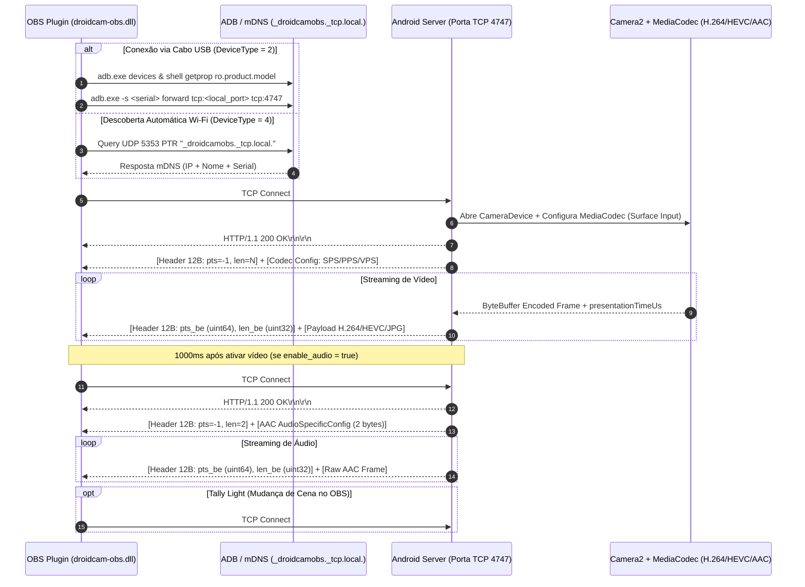

# Engenharia Reversa Completa: DroidCam OBS (Desktop DLL + Android APKM)

> [!IMPORTANT]
> Este documento consolida a análise estática e arquitetural completa do plugin desktop [`droidcam-obs.dll`](file:///C:/Program%20Files/obs-studio/obs-plugins/64bit/droidcam-obs.dll) (v2.5.1, cliente `"251"`) e do pacote Android [`DroidCam APK.apkm`](file:///C:/Program%20Files/obs-studio/data/obs-plugins/droidcam-obs/DroidCam%20APK.apkm) (`com.dev47apps.obsdroidcam` v10.0, build `83`), conduzida via **REA (Reverse Engineer Anything) + Ghidra 12.2**.

---

## 1. Visão Geral da Arquitetura

O ecossistema DroidCam OBS opera no modelo **Servidor no Celular / Cliente no OBS Studio**:
- **Android (`com.dev47apps.obsdroidcam`)**: Executa um serviço em segundo plano (`DroidcamService` + `com.dev47apps.obsdroidcam.core.Server`) que escuta conexões TCP na porta padrão **`4747`** e anuncia sua presença na LAN via mDNS (`_droidcamobs._tcp.local.`). Ele captura vídeo via `android.hardware.camera2` -> `Surface` -> `MediaCodec` (H.264 / HEVC 10-bit HLG) ou `libmjpg.so` (MJPEG via `libjpeg-turbo`) e áudio via `AudioRecord` -> `MediaCodec` (`audio/mp4a-latm` AAC).
- **Desktop ([`droidcam-obs.dll`](file:///C:/Program%20Files/obs-studio/obs-plugins/64bit/droidcam-obs.dll))**: Registra uma fonte assíncrona no OBS (`id = "droidcam_obs"`), descobre dispositivos via mDNS ou túnel USB (`adb.exe forward` / `usbmuxd`), realiza um handshake HTTP simples na porta `4747` e passa a ler pacotes binários com cabeçalho de **12 bytes** contendo o timestamp (`pts`) e o tamanho do frame (`length`), decodificando via FFmpeg (`avcodec-62.dll`) ou `libjpeg-turbo`.



---

## 2. Análise do Plugin Desktop ([`droidcam-obs.dll`](file:///C:/Program%20Files/obs-studio/obs-plugins/64bit/droidcam-obs.dll))

### 2.1 Identificação e Metadados do Binário
- **Caminho do Binário:** [`C:\Program Files\obs-studio\obs-plugins\64bit\droidcam-obs.dll`](file:///C:/Program%20Files/obs-studio/obs-plugins/64bit/droidcam-obs.dll)
- **PDB Associado:** [`C:\Program Files\obs-studio\obs-plugins\64bit\droidcam-obs.pdb`](file:///C:/Program%20Files/obs-studio/obs-plugins/64bit/droidcam-obs.pdb)
- **SHA-256:** `3955e0513391cb4c5ab1c7b0a7370a4a7f784cd8d7d6a7ce8fd23183706d068f` (`2.165.760` bytes)
- **Arquitetura:** PE32+ `x86_64` (Windows, compilado com MSVC + linkagem estática da `libjpeg-turbo` `tj3*`)
- **Dependências Dinâmicas (`inspect_pe_imports`, `ev_8ebf4d162542618dfe4bb370c571e8586da67ce6688553f5e7845b45649f1fcb`):**
  - `obs.dll` (`obs_register_source_s`, `obs_source_output_video2`, `obs_source_output_audio`, `os_process_pipe_create`, etc.)
  - `obs-frontend-api.dll` (`obs_frontend_add_event_callback`, `obs_frontend_get_current_scene`, `obs_frontend_get_current_preview_scene`)
  - `avcodec-62.dll` & `avutil-60.dll` (FFmpeg para decodificação H.264, HEVC, AAC e aceleração por hardware D3D11VA/DXVA2/CUDA)
  - `Qt6Core.dll` & `Qt6Widgets.dll`
  - `WS2_32.dll` (Winsock2 TCP/UDP) & `w32-pthreads.dll`

### 2.2 Inicialização e Registro da Fonte OBS
Na função `obs_module_load` (`0x180001181` -> `0x18010b030`, evidência `ev_2fdf524c7c8c1035cf9d65a57f2e145af6402327fadd40998cf514754c92b5eb`):
1. Verifica a versão do `avcodec`: `if ((avcodec_version() >> 16) <= 62)` (rejeita se `avcodec` for incompatível).
2. Registra `obs_source_info` (`0x78` bytes) com:
   - `id = "droidcam_obs"`
   - `type = OBS_SOURCE_TYPE_INPUT` (`0`)
   - `output_flags = 0x87` (`OBS_SOURCE_VIDEO | OBS_SOURCE_AUDIO | OBS_SOURCE_ASYNC | OBS_SOURCE_DO_NOT_DUPLICATE`)
3. Registra o callback de eventos do frontend (`FUN_18010b340`) para monitorar trocas de cena (`OBS_FRONTEND_EVENT_SCENE_CHANGED`, `OBS_FRONTEND_EVENT_PREVIEW_SCENE_CHANGED`) e acionar o Tally Light no celular.

### 2.3 Mapeamento das Funções Principais no Ghidra

| Endereço | Símbolo / Papel | Descrição Técnica |
| :--- | :--- | :--- |
| `0x18010b030` | `obs_module_load_impl` | Valida `avcodec_version()`, registra `droidcam_obs` source e callbacks de cena. |
| `0x18010b520` | `plugin_create` | Aloca `0x220` bytes para a instância da fonte, lê configurações (`resolution`, `video_format`, `activated`, `uhd_unlock`, `enable_audio`, `hw_accel`, `allow_hdr`) e inicia 4 threads (`video_thread`, `video_decode_thread`, `audio_thread`, `tally_thread`). |
| `0x18010bd60` | `plugin_get_properties` | Constrói a UI de propriedades no OBS; popula a lista de resoluções e codecs (`AVC/H.264`, `HEVC/H.265`, `MJPEG`). |
| `0x18010deb0` | `activate_clicked` | Callback do botão Activate/Deactivate; contém o **Easter Egg `"4K"`** para desbloquear resoluções > 1080p. |
| `0x18010dd70` | `refresh_devices_clicked` | Enumera dispositivos via `AdbMgr` (`adb devices`), `usbmuxd` (iOS) e `mdns` (`_droidcamobs._tcp.local.`). |
| `0x18010c4a0` | `resolve_and_connect` | Resolve o tipo de conexão (`1`=Wi-Fi IP, `2`=ADB USB, `3`=iOS USB, `4`=mDNS) e abre o socket TCP. |
| `0x18010cda0` | `video_thread` | Executa o handshake `GET /v5/video/...`, lê pacotes da rede e enfileira na fila de vídeo (`0x110`). |
| `0x18010c9d0` | `video_decode_thread` | Desenfileira pacotes de vídeo, decodifica via FFmpeg (`FUN_180100c30`) ou `libjpeg-turbo` (`FUN_180102340`) e entrega ao OBS via `obs_source_output_video2`. |
| `0x18010d300` | `audio_thread` | Executa `GET /v2/audio`, decodifica AAC via FFmpeg e entrega ao OBS via `obs_source_output_audio`. |
| `0x18010d700` | `tally_thread` | Envia `PUT /v1/tally/{program\|preview\|idle}/` ao celular quando a visibilidade da fonte muda. |
| `0x18010c6e0` | `read_framed_packet` | Lê o cabeçalho binário de 12 bytes (`uint64_t pts_be` + `uint32_t len_be`) e o payload do socket. |
| `0x1800fee20` | `AdbMgr::check_devices` | Executa `adb.exe devices` e `adb.exe -s <serial> shell getprop ro.product.model` via `os_process_pipe_create`. |
| `0x1800febb0` | `AdbMgr::forward_port` | Executa `adb.exe -s <serial> forward tcp:<local_port> tcp:<app_port>`. |
| `0x180105f50` | `mdns_discovery_thread` | Envia queries mDNS UDP na porta `5353` (`224.0.0.251` e `ff02::fb`) procurando `_droidcamobs._tcp.local.`. |
| `0x180100900` | `ffmpeg_decoder_init` | Inicializa `AVCodecContext` e testa aceleração de hardware (`D3D11VA`, `DXVA2`, `CUDA`). |
| `0x180100c30` | `ffmpeg_decode_video` | Envia `AVPacket`, recebe `AVFrame`, transfere da GPU para RAM (`av_hwframe_transfer_data`) e mapeia `P010`/HDR (`Rec. 2100 HLG/PQ`). |

---

## 3. Especificação Completa do Protocolo de Rede e USB

### 3.1 Camadas de Transporte (`FUN_18010c4a0` @ `0x18010c4a0`)
O plugin suporta 4 modos de transporte, todos convergindo para um **socket TCP padrão**:
1. **Wi-Fi Manual (`DeviceType = 1`):** Conecta diretamente a `<wifi_ip>:<app_port>` (porta padrão `4747`, validada no intervalo `1..65535`).
2. **USB Android via ADB (`DeviceType = 2`):**
   - Usa o executável embutido [`data/obs-plugins/droidcam-obs/adb/adb.exe`](file:///C:/Program%20Files/obs-studio/data/obs-plugins/droidcam-obs/adb/adb.exe).
   - Lista dispositivos com `adb.exe devices`, ignorando dispositivos `offline` ou `unauthorized`.
   - Obtém o nome amigável do aparelho rodando `adb.exe -s <serial> shell getprop ro.product.model`.
   - Mapeia uma porta local efêmera (começando em `4747` / incrementando por instância) com:
     ```powershell
     adb.exe -s <serial> forward tcp:<local_port> tcp:<app_port>
     ```
   - Conecta via TCP em `127.0.0.1:<local_port>`. **Ou seja: o tráfego USB nada mais é do que o mesmo protocolo TCP tunelado pelo daemon ADB!**
3. **USB iOS via `usbmuxd` (`DeviceType = 3`):** Carrega dinamicamente a DLL do iTunes/Apple Mobile Device Support (`usbmuxd_connect`) para tunelar TCP sobre USB no iOS.
4. **Auto-Descoberta mDNS (`DeviceType = 4`):** Envia pacotes DNS multicast para `224.0.0.251:5353` (IPv4) e `[ff02::fb]:5353` (IPv6) consultando PTR `_droidcamobs._tcp.local.`.

### 3.2 Handshake HTTP (Porta `4747`)
Assim que o socket TCP conecta, o plugin envia requisições HTTP minimalistas:

#### Stream de Vídeo (`FUN_18010cda0` @ `0x18010cda0`)
```http
GET /v5/video/{format}/{width}x{height}/port/{port}/os/win/obs/{obs_version}/client/251/hdr/{hdr}/nonce/5912/ HTTP/1.1\r\n\r\n
```
- `{format}`: `"avc"` (H.264), `"hevc"` (H.265) ou `"jpg"` (MJPEG).
- `{width}x{height}`: Resolução solicitada (ex: `1920x1080` ou `3840x2160`).
- `{hdr}`: `1` se `allow_hdr == true` e `format == "hevc"`, caso contrário `0`.
- `{nonce}`: Constante `0x1718` (`5912`).
- **Resposta do Servidor Android:**
  - `HTTP/1.1 200 OK\r\n...` -> Inicia imediatamente o fluxo binário na mesma conexão TCP.
  - `HTTP/1.1 550 ...` -> Versão gratuita bloqueada (`Pro Upgrade Required` para recursos restritos).
  - `HTTP/1.1 555 ...` -> Câmera parada no celular (`Stopped`).
  - `HTTP/1.1 400 ...` -> `BadResolution` ou `InvalidRequest`.

#### Stream de Áudio (`FUN_18010d300` @ `0x18010d300`)
Aberto em uma **segunda conexão TCP** 1000ms após o início do vídeo:
```http
GET /v2/audio HTTP/1.1\r\n\r\n
```

#### Tally Light (`FUN_18010d700` @ `0x18010d700`)
Aberto em uma conexão TCP curta sempre que a cena ativa/preview do OBS muda:
```http
PUT /v1/tally/{state}/ HTTP/1.1\r\n\r\n
```
Onde `{state}` é `"program"`, `"preview"` ou `"idle"`.

### 3.3 Framing Binário dos Pacotes de Mídia (`FUN_18010c6e0` @ `0x18010c6e0`)
Após o `HTTP/1.1 200 OK\r\n\r\n`, o socket deixa de usar texto HTTP e passa a transmitir blocos binários sequenciais. Cada pacote possui um **cabeçalho fixo de 12 bytes em Big-Endian**:

```
 0                   1                   2                   3
 0 1 2 3 4 5 6 7 8 9 0 1 2 3 4 5 6 7 8 9 0 1 2 3 4 5 6 7 8 9 0 1
+-+-+-+-+-+-+-+-+-+-+-+-+-+-+-+-+-+-+-+-+-+-+-+-+-+-+-+-+-+-+-+-+
|                        PTS (High 32 bits)                     |
+-+-+-+-+-+-+-+-+-+-+-+-+-+-+-+-+-+-+-+-+-+-+-+-+-+-+-+-+-+-+-+-+
|                        PTS (Low 32 bits)                      |
+-+-+-+-+-+-+-+-+-+-+-+-+-+-+-+-+-+-+-+-+-+-+-+-+-+-+-+-+-+-+-+-+
|                    Payload Length (32 bits)                   |
+-+-+-+-+-+-+-+-+-+-+-+-+-+-+-+-+-+-+-+-+-+-+-+-+-+-+-+-+-+-+-+-+
|                     Payload Bytes (Length)                  ...
+-+-+-+-+-+-+-+-+-+-+-+-+-+-+-+-+-+-+-+-+-+-+-+-+-+-+-+-+-+-+-+-+
```

- **Bytes `0..7` (`pts`, `uint64_t` Big-Endian):**
  - Se `pts == 0xFFFFFFFFFFFFFFFF` (`-1`): Trata-se de um **Pacote de Configuração de Codec (CSD / Extradata)** com limite máximo de `1024` bytes (`0x400`).
    - No **Vídeo**: Contém os NALUs de configuração (`SPS`/`PPS` para H.264 ou `VPS`/`SPS`/`PPS` para HEVC). O plugin armazena esses bytes em um buffer separado e os **concatena no início do próximo pacote de vídeo normal** antes de entregar ao `avcodec_send_packet`.
    - No **Áudio**: Contém os **2 bytes** do `AudioSpecificConfig` (AAC), usados para extrair `sample_rate` e `channels` e inicializar o `AVCodecContext` de áudio.
  - Se `pts != -1`: É o Presentation Timestamp em **microssegundos** ($\mu\text{s}$). Na função `video_decode_thread` (`0x18010c9d0`), o plugin multiplica esse valor por `1000` (`pts * 1000`) para converter em **nanossegundos** para a estrutura `obs_source_frame2.timestamp`.
- **Bytes `8..11` (`length`, `uint32_t` Big-Endian):**
  - Tamanho exato do payload em bytes. Se `length == 0` ou `length > 0xFFFFFF` (16 MB), o stream é abortado com erro `"bad_packet read (len=%d) -> abort"`.

---

## 4. Limitações Artificiais, Gargalos e o Easter Egg `"4K"`

A engenharia reversa revelou descobertas críticas sobre como o DroidCam OBS funciona por baixo dos panos:

### 4.1 Tabela Fixa de Resoluções e o Desbloqueio Secreto `"4K"` (`0x18010bd60` e `0x18010deb0`)
- Na seção `.rdata` em `0x1802000a8`, o plugin define **apenas 7 resoluções fixas**:
  1. `"640x480"`
  2. `"1024x768"`
  3. `"1280x720"`
  4. `"1920x1080"`
  5. `"1920x1440"`
  6. `"2560x1440"`
  7. `"3840x2160"`
- Na função `plugin_get_properties` (`0x18010bd60`), se a flag booleana `uhd_unlock` nas configurações da fonte for `false`, o loop de preenchimento do dropdown para no índice `3` (`1920x1080`)!
- Na função `activate_clicked` (`0x18010deb0`), existe um **Easter Egg não documentado**:
  ```c
  // Decompilado de FUN_18010deb0 (0x18010deb0)
  wifi_ip = obs_data_get_string(settings, "wifi_ip");
  if ((wifi_ip[0] == '4') && (wifi_ip[1] == 'K' || wifi_ip[1] == 'k') && (wifi_ip[2] == '\0')) {
      obs_data_set_bool(settings, "uhd_unlock", true);
      obs_data_set_string(settings, "wifi_ip", "");
      // Libera 1920x1440, 2560x1440 e 3840x2160 na lista!
  }
  ```
- **Problema Arquitetural:** O plugin Desktop **nunca pergunta ao celular** quais sensores, lentes, resoluções nativas ou taxas de quadros (60 fps, 120 fps) o hardware realmente suporta. Se o celular suportar `4032x3024`, `3840x2160@60fps` ou múltiplas lentes (Ultra-Wide, Principal, Telefoto), o OBS não sabe disso na configuração da fonte.

### 4.2 Gargalo de Cópia GPU -> RAM -> GPU na Decodificação (`0x180100900` e `0x180100c30`)
- Em `FUN_180100900`, quando a opção `hw_accel` está ativada, o plugin tenta criar um contexto de hardware FFmpeg na ordem: `AV_HWDEVICE_TYPE_D3D11VA` (`7`), `AV_HWDEVICE_TYPE_DXVA2` (`2`), `AV_HWDEVICE_TYPE_CUDA` (`4`).
- Porém, em `FUN_180100c30` (`0x180100c30`), assim que a GPU termina de decodificar o frame em uma textura de hardware (`frame->format == hw_pix_fmt`), o plugin executa:
  ```c
  av_hwframe_transfer_data(sw_frame, hw_frame, 0);
  ```
  Isso copia o frame 4K (ex: NV12 ou P010 de ~12 a 24 MB por frame, ou **720 MB/s a 1.4 GB/s em 4K60**) da VRAM da GPU de volta para a memória RAM do sistema, apenas para que o OBS (`obs_source_output_video2`) tenha que fazer upload da RAM de volta para a VRAM via Direct3D 11!

---

## 5. Análise do Pacote Android ([`DroidCam APK.apkm`](file:///C:/Program%20Files/obs-studio/data/obs-plugins/droidcam-obs/DroidCam%20APK.apkm))

### 5.1 Estrutura do Bundle `.apkm`
- **Pacote:** `com.dev47apps.obsdroidcam` (Versão `10.0`, `versionCode = 83`, `minSdkVersion = 23`).
- **Assinatura APK (`inspect_apk_signature`, `ev_0bce33b4d1ef6cae3805fc46ad84d1dbb72f77a0ecf8aea3871decccff53f24e4`):** Assinado via APK Signature Scheme v2/v3 por `CN=DEV47APPS, OU=MOBILE, O=DEV47APPS, L=Ottawa, ST=ON, C=CA` (SHA-256: `e356137e4ab7dfdc8aa7eb6475890f0a06fa63aa0cd760542c83df832a840702`).
- **Proteção e Ofuscação:**
  - Protegido com **Google Play Integrity / PairIP** (`libpairipcore.so` + `com.pairip.licensecheck.LicenseContentProvider`) e **ofuscação de nomes de classes/métodos com dicionário Unicode** (caracteres Etíopes, Cherokee e CJK), exceto nas classes com binding JNI ou registradas no `AndroidManifest.xml`.

### 5.2 Bibliotecas Nativas (`split_config.arm64_v8a.apk`)
1. **`libmdns.so` (`116.584` bytes, SHA-256 `ad46b06ca9346f0e44718f10d5d4357b47d176ab20cf27b9bf20d2666ed35c69`):**
   - Registra via `JNI_OnLoad` (`0x4af0`) três métodos nativos na classe `com.dev47apps.obsdroidcam.core.Server`:
     - `CheckMDNS() : V`
     - `ServiceMDNS() : [B`
     - `StopMDNS() : V`
   - Abre sockets multicast UDP e responde a consultas `_droidcamobs._tcp.local.` e `_services._dns-sd._udp.local.`, além de verificar a assinatura do APK (`META-INF/*.RSA` / `.DSA`) contra adulteração.
2. **`libmjpg.so` (`870.488` bytes, SHA-256 `fa762520e8896150983b170caeb6f1f895c300f65055f2fd07da4dc152369c65`):**
   - Contém a `libjpeg-turbo` compilada com instruções SIMD ARM64 NEON e registra métodos nativos em `com.dev47apps.obsdroidcam.core.VideoEncoder`:
     - `EncoderInit() : I`
     - `EncoderRelease() : V`
     - `EncoderRun() : I`
     - `EncoderRunBB() : I`
     - `JPGBufLen() : I`
     - `SetOverlayText() : V` (usado para estampar marca d'água no vídeo no modo gratuito).

### 5.3 Pipeline de Câmera, Codificação e Controle Remoto no Android
A inspeção dos arquivos DEX (`classes.dex`, `classes2.dex`, `classes3.dex`) e da WebUI embutida (`assets/www/remote.htm`) mostra:
- **Captura de Vídeo (`android.hardware.camera2`):**
  - Enumera câmeras com `CameraManager.getCameraIdList()` e `getCameraCharacteristics()`.
  - Consulta `StreamConfigurationMap.getOutputSizes()`, `CONTROL_AE_AVAILABLE_TARGET_FPS_RANGES`, `CONTROL_ZOOM_RATIO_RANGE`, `LENS_INFO_MINIMUM_FOCUS_DISTANCE` e `REQUEST_AVAILABLE_DYNAMIC_RANGE_PROFILES` (`DynamicRangeProfiles.getSupportedProfiles()`).
  - Para HDR, configura `OutputConfiguration.setDynamicRangeProfile()` com `HEVCProfileMain10` e `COLOR_TRANSFER_HLG` (`"HDR: HEVCProfileMain10 COLOR_TRANSFER_HLG"`).
- **Codificação de Hardware (`android.media.MediaCodec`):**
  - Usa `MediaCodec.createEncoderByType("video/avc")` ou `"video/hevc"` alimentado diretamente via `MediaCodec.createInputSurface()` (zero-copy entre Camera2 e MediaCodec no Android).
  - Consulta `MediaCodecInfo.VideoCapabilities` (`getSupportedWidths()`, `getSupportedHeights()`, `getSupportedFrameRatesFor()`, `getBitrateRange()`, `getSupportedPerformancePoints()`).
- **API REST de Controle Remoto (servida na porta `4747`):**
  - Quando ativado no OBS, o plugin define `remote_url = "http://<ip>:<port>"` nas configurações da fonte para exibir um painel de controle (baseado em `assets/www/remote.htm`).
  - Porém, no DroidCam OBS oficial, o controle remoto e o modo sem marca d'água / 4K completo retornam **HTTP Status `550`** (`#overlay-get-pro` -> *"Get Pro for remote control"*).
  - Endpoints REST identificados no servidor Android:
    - `GET /v1/phone/name` -> Nome do modelo do celular
    - `GET /v1/phone/battery_info` -> JSON `{"level": 0..100, "state": -1|0|1}`
    - `GET /v1/camera/camera_list` -> Lista de lentes/câmeras separada por `\n`
    - `GET /v1/camera/info` -> JSON completo com estado atual e limites (`active`, `led_on`, `wbMode`, `wbLock`, `wbValue`, `wbMin`, `wbMax`, `focusMode`, `mfValue`, `mfMin`, `mfMax`, `zmValue`, `zmMin`, `zmMax`, `evValue`, `evMin`, `evMax`, `isoValue`, `isoMin`, `isoMax`, `isoMap`, `ssValue`, `ssMin`, `ssMax`, `ssMap`, `aeLock`, `isoLock`, `ssLock`, `audioMute`)
    - `PUT /v1/camera/active/{index}` -> Troca de lente/câmera
    - `PUT /v3/camera/zoom/{val}` -> Zoom óptico/digital
    - `PUT /v3/camera/ev/{val}` -> Compensação de exposição (EV)
    - `PUT /v3/camera/iso/{val}` & `PUT /v3/camera/ss/{val}` -> ISO e Shutter Speed manuais
    - `PUT /v2/camera/wb_level/{val}` & `PUT /v1/camera/wb_mode/{mode}` -> Balanço de branco
    - `PUT /v3/camera/mf/{val}` & `PUT /v1/camera/autofocus_mode/{mode}` & `PUT /v1/camera/autofocus` -> Foco automático/manual
    - `PUT /v1/camera/torch_toggle`, `PUT /v1/camera/mic_toggle`, `PUT /v1/camera/ae_toggle`, `PUT /v1/camera/el_toggle`, `PUT /v1/camera/wbl_toggle`
    - `PUT /v1/tally/{program|preview|idle}` -> Indicador de cena ativa no celular
    - `PUT /v1/stop` & `PUT /v1/restart`

---

## 6. Como Nosso Sistema (`Cameraphone Plugin OBS`) Vai Superar o DroidCam OBS

| Recurso / Aspecto | DroidCam OBS (Analisado) | Nosso Projeto (`Cameraphone Plugin OBS`) |
| :--- | :--- | :--- |
| **Detecção de Resolução e FPS** | Lista hardcoded de 7 resoluções no PC; esconde 1440p/4K atrás de um easter egg (`"4K"` no IP) e não sabe quais FPS ou lentes o celular tem. | **Handshake de Capacidades Dinâmico (`GET /api/v1/capabilities`)**: O Android interroga `CameraCharacteristics` + `MediaCodecList` e envia ao OBS todas as lentes físicas (Ultra-Wide, Wide, Telefoto, Frontal), resoluções reais (até 4K/8K suportadas pelo encoder), taxas de quadros (30/60/120 FPS) e suporte a HDR10/HLG. |
| **Qualidade & Bitrate** | Bitrate fixo/limitado sem controle fino no OBS. | **Controle de Bitrate, Codec (HEVC / AVC / AV1) e Perfil de Cor (SDR / HLG / HDR10 10-bit)** diretamente na UI da fonte no OBS, ajustado para Wi-Fi (ex: 15–50 Mbps) ou Cabo USB (ex: 50–150 Mbps). |
| **Controles Pro da Câmera** | Bloqueados atrás de paywall (`HTTP 550 Get Pro`) e em uma WebUI separada. | **100% Grátis e Nativo nas Propriedades/Dock do OBS**: Troca de lente sem reiniciar stream, Zoom suave, ISO, Shutter Speed ($1/N$), Foco Manual, WB Kelvin, Lanterna, Telemetria de Bateria/Temperatura e Tally Light. |
| **Conexão USB & Rede** | `adb.exe forward` sobre TCP + mDNS na LAN. | **Mesma praticidade (ADB USB Zero-Config + mDNS Auto-Discovery)**, com reconexão automática instantânea e TCP `TCP_NODELAY` / buffers otimizados para latência ultra-baixa. |

---

## 7. Registro de Evidências (REA + Ghidra)

- `ev_95b323b8274f71244fb416e5cb72b5d7dbd65cea3e869eedbc39ecbed15143e3`: `inspect_native_exports` (`droidcam-obs.dll`)
- `ev_8ebf4d162542618dfe4bb370c571e8586da67ce6688553f5e7845b45649f1fcb`: `inspect_pe_imports` (`droidcam-obs.dll`)
- `ev_0c2a043cf3e331477819546b0d4d9e4bddeaa8151eda03ccc60adfa82428ed7e`: `binary_overview` Ghidra 12.2 (`droidcam-obs.dll`, 5.086 procedimentos)
- `ev_2fdf524c7c8c1035cf9d65a57f2e145af6402327fadd40998cf514754c92b5eb`: `procedure_pseudo_code` de `obs_module_load_impl` (`0x18010b030`)
- `ev_406049da700dd502ea841a0fc51c2f20b361e2d198eb092ab5115b3fcda72c7f`: `procedure_pseudo_code` de `video_thread` (`0x18010cda0`)
- `ev_ef6550a859bb2802af0b8a55aa2c37d7f0ab296d515889f416e810a925e97346`: `procedure_pseudo_code` de `audio_thread` (`0x18010d300`)
- `ev_ff86763f5406346fc6d27ca1d0466ce180f3f04fee122a739a4d90c5b28734b5`: `procedure_pseudo_code` de `tally_thread` (`0x18010d700`)
- `ev_4a1efe17ea26d488dfcb56511148b34c874a134c3a5ecc71f6c58f431d9181a9`: `procedure_pseudo_code` de `read_framed_packet` (`0x18010c6e0`)
- `ev_2baeb5f08c1c3eba844030dd390298b618f313e357e94006607dd7836f481c31`: `procedure_pseudo_code` de `resolve_and_connect` (`0x18010c4a0`)
- `ev_e1b1846df440060ef8c4076554965b2824fc769ff1c09077a474124d776a32a5`: `procedure_pseudo_code` de `plugin_get_properties` (`0x18010bd60`)
- `ev_95df5d3c16c7f6f97683e1f7d1bb712630833849c367c6a98a8858062fa00368`: `procedure_pseudo_code` de `activate_clicked` (`0x18010deb0`)
- `ev_39c8b595b08158ac32019b4abe4a51e6461901e203a2b776c34c88b56344c6c7`: `procedure_pseudo_code` de `ffmpeg_decoder_init` (`0x180100900`)
- `ev_f990b67afb95f3cb3ea661decc4b032bdbf2593d60d8f9ee9a0f2b4769562500`: `procedure_pseudo_code` de `ffmpeg_decode_video` (`0x180100c30`)
- `ev_7ee8f351c9c3650d25a95f2b389dd57b1e2b94279cf48cff948800bc87cf99f1`: `procedure_pseudo_code` de `AdbMgr::check_devices` (`0x1800fee20`)
- `ev_3053a91279db9d4e6af174913a6864322abd08d2cfce53b8a77dbf12012e2774`: `procedure_pseudo_code` de `AdbMgr::forward_port` (`0x1800febb0`)
- `ev_756332dc5277e923fef81b4cefc302a58beadaa516471368df3056982964a515`: `procedure_pseudo_code` de `mdns_discovery_thread` (`0x180105f50`)
- `ev_0bce33b4d1ef6cae3805fc46ad84d1dbb72f77a0ecf8aea371decccff53f24e4`: `inspect_apk_signature` (`base.apk`)
- `ev_b048c318a08088cd5ea5b20be460df0e16ed773565820389dcbfc816de6386cb`: `inspect_native_exports` (`libmdns.so`)
- `ev_7ce2609fd6caa089204ccdd8072de7ff6233d934258be09da118c3a60ad95ae7`: `inspect_native_exports` (`libmjpg.so`)
